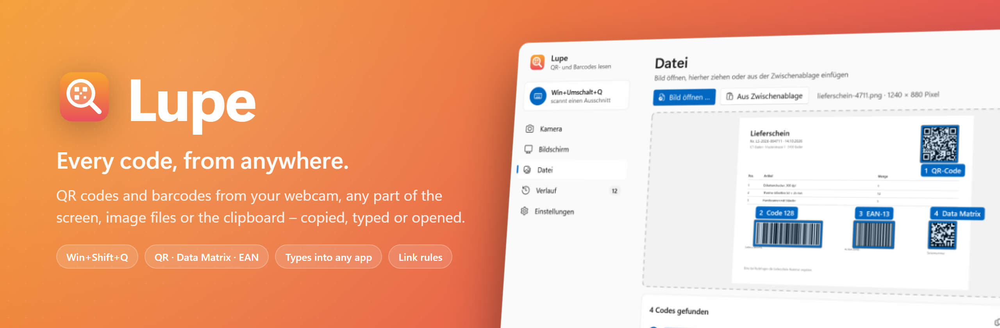
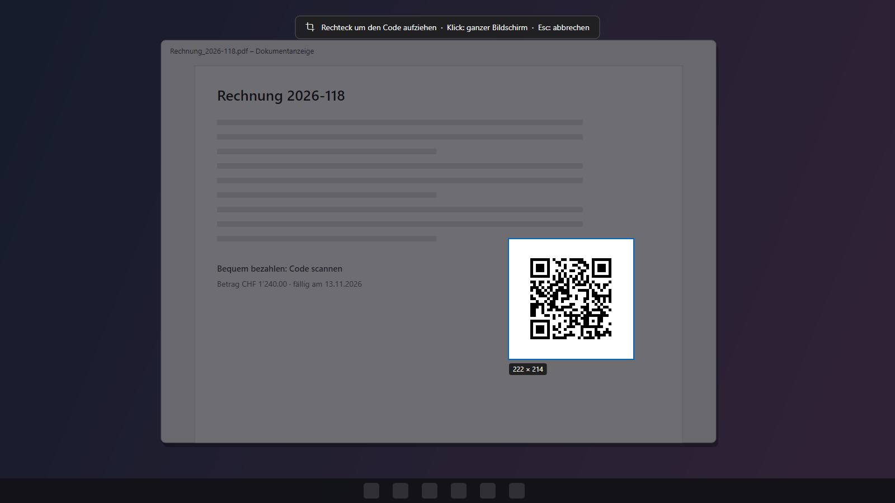
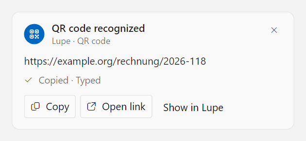
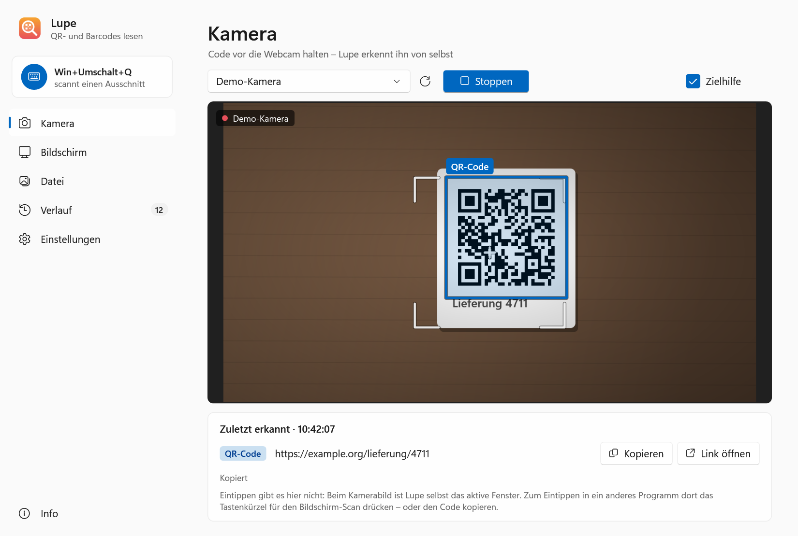
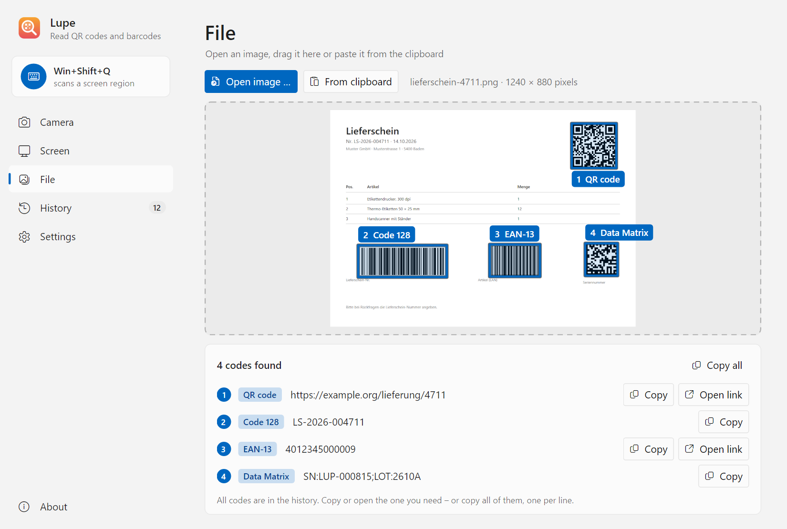
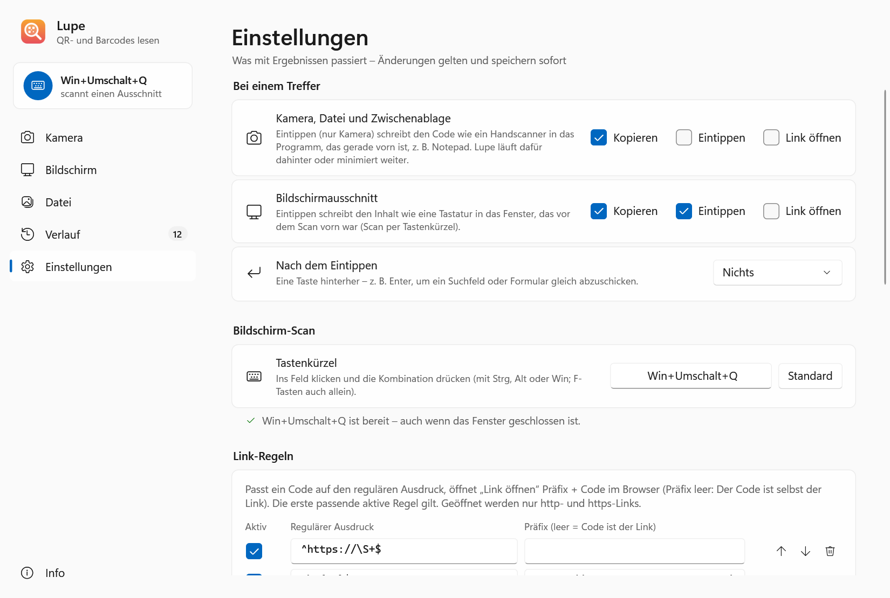
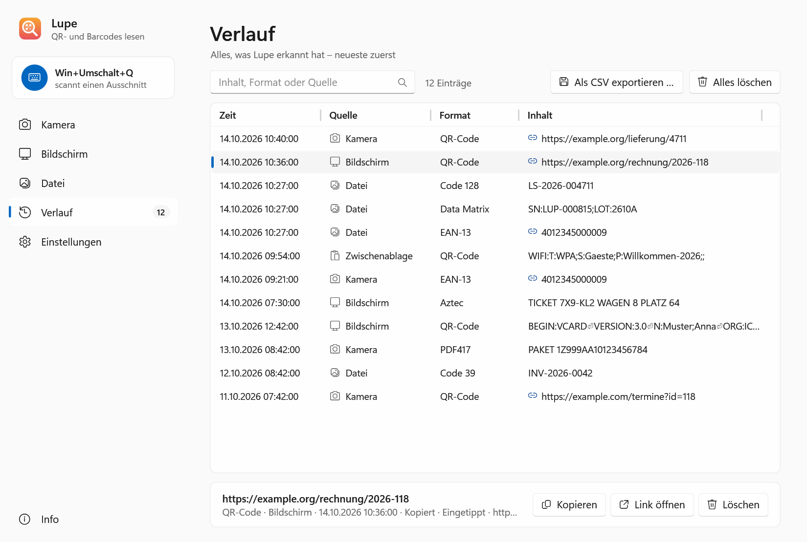

<p align="center">
  
</p>

<p align="center">
  <a href="https://github.com/ict-baden/lupe/releases/latest"></a>
  
  
  
  
  
  
  <a href="LICENSE"></a>
  
  <a href="https://github.com/ict-baden/lupe/actions/workflows/build.yml"></a>
</p>

<p align="center">
  <b><a href="https://github.com/ict-baden/lupe/releases/latest">Download</a></b>
  &nbsp;·&nbsp; <a href="#what-lupe-does">Features</a>
  &nbsp;·&nbsp; <a href="#quick-start">Quick start</a>
  &nbsp;·&nbsp; <a href="#supported-formats">Formats</a>
  &nbsp;·&nbsp; <a href="#documentation">Documentation</a>
  &nbsp;·&nbsp; <a href="#limits-honestly">Limits</a>
</p>

<br>

<p align="center">
  <b>Read every QR code and barcode on Windows, Linux and macOS – wherever it is.</b><br>
  Lupe reads codes from a webcam, from any part of the screen, from image files and from the clipboard.<br>
  It copies the content, types it into the window you were working in, or, when it matches one of your link rules, opens the resulting link.
</p>

<p align="center">
  <sub>Win+Shift+Q from any program &nbsp;·&nbsp; keeps running in the notification area &nbsp;·&nbsp; finds all codes in a picture &nbsp;·&nbsp; nothing is sent to the internet</sub>
</p>

> [!NOTE]
> **Deutsch:** Lupe liest QR- und Barcodes per Webcam, aus einem Bildschirmausschnitt, aus Bilddateien und aus der Zwischenablage, unter Windows, Linux und macOS. Das Ergebnis wird kopiert, in das Programm vorn eingetippt oder als Link geöffnet. Download: die aktuelle Version unter [Releases](https://github.com/ict-baden/lupe/releases/latest), der neueste Build von `main` unter [„latest“](https://github.com/ict-baden/lupe/releases/tag/latest). Die Oberfläche gibt es auf Deutsch, Englisch, Spanisch, Französisch und Chinesisch (die letzten drei maschinell übersetzt, noch nicht gegengelesen); sie folgt der Sprache des Systems. Diese Doku ist Englisch.

> [!NOTE]
> **The application speaks English, German, Spanish, French and Chinese (simplified)** – the last three are machine translations that native speakers have not reviewed yet. It follows the language of the operating system (English for any other language) and can be switched under *Settings › Language*. This documentation quotes the English labels, for example *Screen*, *Type* or *Open link*; the German interface shows *Bildschirm*, *Eintippen* and *Link öffnen* in their place.

## What Lupe does

<table>
  <tr>
    <td width="33%" align="center" valign="middle">
      <picture>
        <source media="(prefers-color-scheme: dark)" srcset="docs/assets/screenshots/selection-dark.png">
        
      </picture>
    </td>
    <td width="33%" align="center" valign="middle">
      <picture>
        <source media="(prefers-color-scheme: dark)" srcset="docs/assets/screenshots/result-dark.png">
        
      </picture>
    </td>
    <td width="33%" align="center" valign="middle">
      <picture>
        <source media="(prefers-color-scheme: dark)" srcset="docs/assets/screenshots/camera-dark.png">
        
      </picture>
    </td>
  </tr>
  <tr>
    <td valign="top"><b>Any part of the screen</b><br>
      Press <kbd>Win</kbd>+<kbd>Shift</kbd>+<kbd>Q</kbd> in any program and drag a rectangle around the code – across all monitors, also with the Lupe window closed.</td>
    <td valign="top"><b>Typed into the app you came from</b><br>
      With <i>Type</i> switched on, the content goes into the window that was active before the scan – as keyboard input, optionally followed by <kbd>Enter</kbd> or <kbd>Tab</kbd>.</td>
    <td valign="top"><b>Webcam</b><br>
      Hold a code in front of the camera. Lupe marks it and beeps; the same code is reported again only after it has been out of sight for 3 seconds.</td>
  </tr>
  <tr>
    <td align="center" valign="middle">
      <picture>
        <source media="(prefers-color-scheme: dark)" srcset="docs/assets/screenshots/file-dark.png">
        
      </picture>
    </td>
    <td align="center" valign="middle">
      <picture>
        <source media="(prefers-color-scheme: dark)" srcset="docs/assets/screenshots/settings-dark.png">
        
      </picture>
    </td>
    <td align="center" valign="middle">
      <picture>
        <source media="(prefers-color-scheme: dark)" srcset="docs/assets/screenshots/history-dark.png">
        
      </picture>
    </td>
  </tr>
  <tr>
    <td valign="top"><b>Files and clipboard</b><br>
      Open an image, drag it onto the <i>File</i> page or press <kbd>Ctrl</kbd>+<kbd>V</kbd>. Every code in the picture is found and numbered.</td>
    <td valign="top"><b>Link rules</b><br>
      A regular expression and an optional prefix turn a code into a link, e.g. an EAN into the item page of your ERP. Only <code>http</code> and <code>https</code> are ever opened.</td>
    <td valign="top"><b>History</b><br>
      Everything Lupe has read, searchable and exportable as CSV for Excel. Stored per user – or switched off, which deletes the file.</td>
  </tr>
</table>

### And also

<table>
  <tr>
    <td width="50%" valign="top"><b>Every code in the picture</b><br>Several codes are reported in reading order. After a screen scan you pick one (<i>N codes found – which one?</i>) or copy them all, one per line</td>
    <td width="50%" valign="top"><b>Small codes on big screens</b><br>4K screenshots are searched as an overview plus overlapping tiles in full resolution; if nothing turns up, a thorough second pass tries rotated versions (smaller pictures also enlarged or halved)</td>
  </tr>
  <tr>
    <td valign="top"><b>Typing that does not depend on the keyboard layout</b><br>Unicode keyboard input: umlauts, € and emoji arrive as they are. Lupe waits until you have let go of the shortcut keys and does not type into a window running as administrator</td>
    <td valign="top"><b>Links that stay where you sent them</b><br>Behind a prefix with a host, the code is percent-encoded and the finished link must keep that host – the code cannot redirect you to another site. Without a prefix, like the default rule, the code itself is the link, to any host, but only <code>http</code>/<code>https</code></td>
  </tr>
  <tr>
    <td valign="top"><b>Runs in the notification area</b><br>Closing the window keeps Lupe and its shortcut running; optionally it starts with Windows. One Lupe per Windows session</td>
    <td valign="top"><b>Command line</b><br><code>Lupe.exe read C:\Scans\*.png</code> prints one line per code, <code>FORMAT⇥content</code>, with exit codes 0, 1 and 3 for scripts</td>
  </tr>
</table>

## Quick start

<table>
  <tr>
    <td width="33%" valign="top"><b>① Download</b><br>MSI for all users, or the single <code>Lupe.exe</code> that runs without installation and without a .NET runtime.</td>
    <td width="33%" valign="top"><b>② Scan</b><br>Press <kbd>Win</kbd>+<kbd>Shift</kbd>+<kbd>Q</kbd> and drag a rectangle around a code. A click without dragging takes the whole monitor, <kbd>Esc</kbd> cancels.</td>
    <td width="33%" valign="top"><b>③ Use the result</b><br>The content is on the clipboard. To have it typed into the window you came from, tick <i>Type</i> under <i>Settings › Screen region</i>.</td>
  </tr>
</table>

**① Download** – the current version is **Lupe 1.0.0**, the release marked [**Latest**](https://github.com/ict-baden/lupe/releases/latest) under *Releases* on the right of the repository page. Its file names carry the version; only `Lupe.exe` keeps its name, so [`releases/latest/download/Lupe.exe`](https://github.com/ict-baden/lupe/releases/latest/download/Lupe.exe) always delivers the current version:

| File | What it is |
|---|---|
| [`Lupe-1.0.0-x64.msi`](https://github.com/ict-baden/lupe/releases/download/v1.0.0/Lupe-1.0.0-x64.msi) | Installer for all users, Start menu entry, no autostart; .NET included. |
| [`Lupe.exe`](https://github.com/ict-baden/lupe/releases/download/v1.0.0/Lupe.exe) | A single file that runs without installation; .NET included. |
| [`Lupe-1.0.0-win-x64-framework.zip`](https://github.com/ict-baden/lupe/releases/download/v1.0.0/Lupe-1.0.0-win-x64-framework.zip) | Small variant; needs the .NET 10 Runtime. |
| [`lupe_1.0.0_amd64.deb`](https://github.com/ict-baden/lupe/releases/download/v1.0.0/lupe_1.0.0_amd64.deb) | Linux package for Debian and Ubuntu (x64): `sudo apt install ./lupe_1.0.0_amd64.deb`. |
| [`Lupe-1.0.0-linux-x64.tar.gz`](https://github.com/ict-baden/lupe/releases/download/v1.0.0/Lupe-1.0.0-linux-x64.tar.gz), [`Lupe-1.0.0-linux-arm64.tar.gz`](https://github.com/ict-baden/lupe/releases/download/v1.0.0/Lupe-1.0.0-linux-arm64.tar.gz) | Linux, any distribution with glibc 2.31 or later (Ubuntu 20.04, Debian 11 and newer): unpack and run `lupe/install.sh` (per user, no root). |
| [`Lupe-1.0.0-macos-arm64.zip`](https://github.com/ict-baden/lupe/releases/download/v1.0.0/Lupe-1.0.0-macos-arm64.zip), [`Lupe-1.0.0-macos-x64.zip`](https://github.com/ict-baden/lupe/releases/download/v1.0.0/Lupe-1.0.0-macos-x64.zip) | `Lupe.app` for Apple Silicon or Intel Macs, not yet notarised: the first time, allow it under *System Settings › Privacy & Security › Open Anyway* ([how](docs/installation.md#macos)). macOS is only partly tested, see [Limits](#limits-honestly). |

Checksums of all files: [`SHA256SUMS.txt`](https://github.com/ict-baden/lupe/releases/download/v1.0.0/SHA256SUMS.txt). What changed: [CHANGELOG](CHANGELOG.md).

<details>
<summary><b>Newest build from <code>main</code></b> (pre-release <i>latest</i>, for trying out changes, not for distribution)</summary>

The pre-release [**latest**](https://github.com/ict-baden/lupe/releases/tag/latest) is rebuilt from `main` every night when `main` has changed. It is tested like a version but may contain changes that are not released yet. Its file names stay the same, so these links always deliver the newest build:

| File | What it is |
|---|---|
| [`Lupe-x64.msi`](https://github.com/ict-baden/lupe/releases/download/latest/Lupe-x64.msi) | Installer for all users, Start menu entry, no autostart; .NET included. |
| [`Lupe.exe`](https://github.com/ict-baden/lupe/releases/download/latest/Lupe.exe) | A single file that runs without installation; .NET included. |
| [`Lupe-win-x64-framework.zip`](https://github.com/ict-baden/lupe/releases/download/latest/Lupe-win-x64-framework.zip) | Small variant; needs the .NET 10 Runtime. |
| [`lupe_amd64.deb`](https://github.com/ict-baden/lupe/releases/download/latest/lupe_amd64.deb) | Linux package for Debian and Ubuntu (x64): `sudo apt install ./lupe_amd64.deb`. |
| [`Lupe-linux-x64.tar.gz`](https://github.com/ict-baden/lupe/releases/download/latest/Lupe-linux-x64.tar.gz), [`Lupe-linux-arm64.tar.gz`](https://github.com/ict-baden/lupe/releases/download/latest/Lupe-linux-arm64.tar.gz) | Linux, any distribution with glibc 2.31 or later (Ubuntu 20.04, Debian 11 and newer): unpack and run `lupe/install.sh` (per user, no root). |
| [`Lupe-macos-arm64.zip`](https://github.com/ict-baden/lupe/releases/download/latest/Lupe-macos-arm64.zip), [`Lupe-macos-x64.zip`](https://github.com/ict-baden/lupe/releases/download/latest/Lupe-macos-x64.zip) | `Lupe.app` for Apple Silicon or Intel Macs, not yet notarised: the first time, allow it under *System Settings › Privacy & Security › Open Anyway* ([how](docs/installation.md#macos)). |

</details>

All variants include .NET except the framework ZIP. On macOS the default shortcut is <kbd>⌘</kbd>+<kbd>⌥</kbd>+<kbd>Q</kbd> (<kbd>⌘</kbd>+<kbd>⇧</kbd>+<kbd>Q</kbd> logs out there).

Requirements, downloading from the command line, the camera and screen permissions on each system, autostart and uninstalling: **[Installation →](docs/installation.md)**

**② Scan** – the shortcut works in every program as long as Lupe is running, also when its window is closed. The camera, files and the clipboard are on the pages *Camera* and *File*. Walkthrough: **[Using the app →](docs/usage.md)**

**③ Use the result** – by default Lupe only copies. What happens with a result is set separately for the screen scan and for camera, file and clipboard: *Copy*, *Type* (after a screen scan into the window you came from, from the camera like a hand scanner into the program in front) and *Open link*. Every setting with its default: **[Settings →](docs/settings.md)** – and how links are built: **[Link rules →](docs/link-rules.md)**

### From the command line

The same `Lupe.exe` reads image files without opening a window. One line per code – the format, a tab, the content:

```bat
Lupe.exe read delivery-note-4711.png
```

```text
QR_CODE	https://example.org/lieferung/4711
CODE_128	LS-2026-004711
EAN_13	4012345000009
DATA_MATRIX	SN:LUP-000815;LOT:2610A
```

| Exit code | Meaning |
|---|---|
| `0` | at least one code found |
| `1` | no code found |
| `3` | error – an image is missing or unreadable, wrong call, cancelled – even if other images had codes |

Wildcards, `--format`, encoding and why a command prompt needs `start /wait`: **[Command line →](docs/command-line.md)**

## Supported formats

Lupe reads 22 formats with [zxing-cpp](https://github.com/zxing-cpp/zxing-cpp) 3.1.1 (NuGet package `ZXingCpp` 0.5.3). All are active by default; *Settings › Formats* can limit them. The column *Name* is what the option `--format` and the settings file expect – the names of the earlier versions are unchanged.

| Format | Name | Kind | Notes |
|---|---|---|---|
| QR Code | `QR_CODE` | 2D | Model 1 and 2; several codes close together are separated |
| Data Matrix | `DATA_MATRIX` | 2D | square and rectangular |
| Aztec | `AZTEC` | 2D | Aztec runes are not read |
| PDF417 | `PDF_417` | 2D (stacked) | also Compact PDF417 |
| MaxiCode | `MAXICODE` | 2D | only from clean, upright images – see [Limitations](docs/limitations.md#decoding) |
| Micro QR Code | `MICRO_QR_CODE` | 2D | new in this version |
| rMQR Code | `RMQR_CODE` | 2D | rectangular Micro QR, new |
| MicroPDF417 | `MICRO_PDF_417` | 2D (stacked) | new |
| Code 128 | `CODE_128` | 1D | GS1-128 with the group separator (`\x1D`) after variable-length fields |
| Code 39 | `CODE_39` | 1D | read as printed: a check digit is not verified, Full ASCII is not expanded |
| Code 93 | `CODE_93` | 1D |  |
| Codabar | `CODABAR` | 1D | without the start and stop characters |
| ITF (Interleaved 2 of 5) | `ITF` | 1D | also ITF-14 |
| EAN-13, EAN-8 | `EAN_13`, `EAN_8` | 1D | without the 2- or 5-digit add-on |
| UPC-A, UPC-E | `UPC_A`, `UPC_E` | 1D | 12 and 8 digits, without the add-on |
| GS1 DataBar | `RSS_14` | 1D | also the stacked variants; the 14-digit GTIN |
| GS1 DataBar Expanded | `RSS_EXPANDED` | 1D | single row and stacked; text in brackets, `(01)…(3103)…` |
| GS1 DataBar Limited | `RSS_LIMITED` | 1D | new; the 14-digit GTIN |
| Telepen | `TELEPEN` | 1D | new |
| DX film edge | `DX_FILM_EDGE` | 1D | new; the code on the edge of 35 mm film |

Light codes on dark backgrounds – dark mode, displays – are read in every format by the screen scan, files, the clipboard and the command line, also next to dark-on-light codes. The camera reads light 2D codes (QR, Data Matrix, Aztec, PDF417, MaxiCode), not light barcodes.

**Not supported:** Intelligent Mail (`IMB`) – the earlier library read it, zxing-cpp does not; MSI, Pharmacode and Plessey. Why and how the search works: **[How it works →](docs/how-it-works.md)**

## Compared with Barcode-Reader

Lupe is a rewrite of the earlier internal Barcode-Reader (.NET Framework 4.5.2, AForge for the webcam) on a current stack: .NET 10, Avalonia (Windows, Linux, macOS) with the Windows 11 look of the sibling tools Vitrine and Zutritt, `Windows.Media.Capture` for the camera on Windows.

| | Barcode-Reader | Lupe |
|---|---|---|
| Webcam scan with marking, aim help and beep | ✔︎ | ✔︎ *Aim guide*, *Sound on detection* |
| Freeze time for repeated codes | ✔︎ | ✔︎ *Repeat lock*, counted from the last sighting |
| Open links by regex whitelist with prefix | ✔︎ | ✔︎ several *Link rules*, only `http`/`https`, code percent-encoded behind a host |
| Hand the content to another program | ✔︎ paste | ✔︎ Unicode typing into the window that was active before the screen scan, optional <kbd>Enter</kbd>/<kbd>Tab</kbd> |
| Screen region with a global shortcut, all monitors | – | ✔︎ |
| Image files, drag and drop, clipboard | – | ✔︎ |
| History with search and CSV export | – | ✔︎ |
| Settings | `config.xml` in *Documents* | *Settings* page, `%LocalAppData%\Lupe\einstellungen.json` |
| Command line | – | ✔︎ `read` |
| EAN/UPC 2- and 5-digit add-ons | ✔︎ | – not part of the result |
| Save camera image to disk, custom logo and colours, debug level | ✔︎ | – Lupe stores no images and follows the Windows light/dark setting |

<sub>“–” = not available; for Barcode-Reader: not among its documented features. Lupe does not read the old <code>config.xml</code> – link rules have to be entered again.</sub>

## Documentation

<table>
  <tr>
    <td width="50%" valign="top"><a href="docs/installation.md"><b>Installation</b></a><br><sub>Windows (MSI, single exe, ZIP), Linux (.deb, tar.gz), macOS (Lupe.app), requirements, permissions, autostart, updates and uninstalling</sub></td>
    <td width="50%" valign="top"><a href="docs/usage.md"><b>Using the app</b></a><br><sub>Every page with screenshots, the screen scan step by step, workflows such as “scan from the screen, type into the ERP”</sub></td>
  </tr>
  <tr>
    <td valign="top"><a href="docs/settings.md"><b>Settings</b></a><br><sub>Every setting with its default, where it applies, the settings file and what happens when it is broken or locked</sub></td>
    <td valign="top"><a href="docs/link-rules.md"><b>Link rules</b></a><br><sub>Pattern and prefix, the three ways a link is built, examples, and the safety checks</sub></td>
  </tr>
  <tr>
    <td valign="top"><a href="docs/command-line.md"><b>Command line</b></a><br><sub>Reading images with <code>read</code>, choosing formats, output and exit codes, encoding, waiting with <code>start /wait</code>, Linux and macOS, <code>--version</code> and <code>--info</code>, start switches</sub></td>
    <td valign="top"><a href="docs/how-it-works.md"><b>How it works</b></a><br><sub>Decoding stages, live vs. thorough search, phantom-code protection, screen capture and DPI, typing, camera</sub></td>
  </tr>
  <tr>
    <td valign="top"><a href="docs/data-and-privacy.md"><b>Data &amp; privacy</b></a><br><sub>What is stored where, the history file, clipboard, autostart entry, network connections</sub></td>
    <td valign="top"><a href="docs/limitations.md"><b>Limitations</b></a><br><sub>What was tested where (macOS only partly), elevated windows, control characters, encodings and other honest limits</sub></td>
  </tr>
  <tr>
    <td valign="top"><a href="docs/error-codes.md"><b>Error codes</b></a><br><sub>Messages with a code such as <code>LUP-0001</code>: what they mean and what to do</sub></td>
    <td valign="top"><a href="docs/development.md"><b>Development</b></a><br><sub>Building with .NET 10, about 1,300 tests and which ones skip themselves, architecture, CI and releases, the self-built zxing-cpp library, MSI, regenerating the screenshots</sub></td>
  </tr>
</table>

## Limits, honestly

- **Tested on Windows and Linux, on macOS only partly.** On a real Mac, Lupe 1.0.0 has been started with its window, the demo camera and the command line; the screen scan, typing, the shortcut and a real camera are untested there. Details: [Limitations › Status](docs/limitations.md#status).
- **Automated tests without webcam and desktop.** On CI the camera path runs against a simulated frame source; screen capture, the global shortcut and typing have tests that need a visible desktop and skip themselves there.
- **Windows protects elevated windows.** Lupe cannot type into a program that runs as administrator unless Lupe runs as administrator too. It detects this, types nothing and says so in the result notification.
- **Control characters are not typed.** The group separator in GS1 codes, for example, is dropped when typing; the command line shows it as `\x1D`.
- **MaxiCode** is only found in clean, upright images.
- **Command line into a pipe** uses the console's code page; characters outside it are replaced. Redirect into a file for lossless UTF-8.
- **Wayland goes through the desktop portals.** The screen scan, typing and the shortcut ask for permission there, and not every desktop offers every portal; Lupe cannot see which window is in front. Details: [Limitations › Linux and macOS](docs/limitations.md#linux-and-macos).
- **Not code-signed yet.** SmartScreen may warn; macOS Gatekeeper asks once.
- **Licence: MIT.** Lupe is under the [MIT licence](LICENSE), like all software of ICT Baden GmbH. The licences of the bundled third-party components (zxing-cpp with libzint and libzueci, Avalonia, SkiaSharp and HarfBuzzSharp with the libraries compiled into them, ANGLE, MicroCom, C#/WinRT, the Windows SDK projection, .NET and more) are in [THIRD-PARTY-NOTICES.txt](THIRD-PARTY-NOTICES.txt), which ships in every package and opens from *About › Recognition and user interface › License texts*.

Everything else: **[Limitations →](docs/limitations.md)**

## Build it yourself

```powershell
dotnet build Lupe.sln
dotnet test Lupe.sln     # camera, desktop and timing tests skip themselves where they cannot run
dotnet run --project src/Lupe -- --demo      # window with demo camera and sample history, saves nothing
```

Needs the .NET 10 SDK (`global.json`: 10.0.100, roll forward to the latest feature band). MSI, CI, architecture and screenshots: **[Development →](docs/development.md)**

## Publisher

Lupe is published by **ICT Baden GmbH** – free and open source software under the [MIT licence](LICENSE).

| | |
|---|---|
| Product page | [ict-baden.de/produkte/lupe](https://ict-baden.de/produkte/lupe/) |
| Legal notice (Impressum) | [ict-baden.de/impressum](https://ict-baden.de/impressum/) |
| Privacy notice for Lupe (Datenschutz) | [ict-baden.de/datenschutz/lupe](https://ict-baden.de/datenschutz/lupe/) – what the app stores locally: [Data & privacy](docs/data-and-privacy.md) |
| Support | free via GitHub, guaranteed with a [support contract](SUPPORT.md) |
| Security | [SECURITY.md](SECURITY.md) |
| Changes | [CHANGELOG.md](CHANGELOG.md) |
| Third-party licences | [THIRD-PARTY-NOTICES.txt](THIRD-PARTY-NOTICES.txt) |

<br>

<p align="center">
  <br>
  <sub><b>Lupe</b> · Every code, from anywhere · published by ICT Baden GmbH</sub>
</p>
