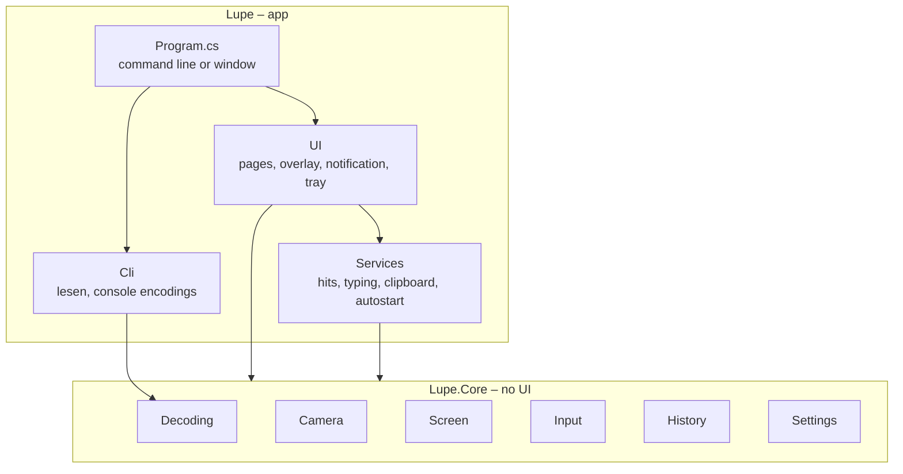

<sub><a href="../README.md">Lupe</a> › <a href="../README.md#documentation">Documentation</a> › Development</sub>

# Development

Building, testing and releasing Lupe, how the code is organised, and how the images in this documentation are made.

**Contents:** [Requirements](#requirements) · [Build](#build) · [Tests](#tests) · [Architecture](#architecture) · [MSI](#msi) · [CI and releases](#ci-and-releases) · [Screenshots and images](#screenshots-and-images) · [Demo and screenshot switches](#demo-and-screenshot-switches)

## Requirements

- **.NET 10 SDK.** `global.json` pins `10.0.100` with `rollForward: latestFeature`, so newer 10.0 feature bands work too.
- **Windows** to run the app and the tests. Both projects target `net10.0-windows10.0.19041.0` (the Windows SDK version for `Windows.Media.Capture`) with a minimum of Windows 10 1809, and set `EnableWindowsTargeting`, so they can also be compiled elsewhere.
- For the MSI: nothing extra – the WiX Toolset comes as an MSBuild SDK (`WixToolset.Sdk` 5.0.2, plus `WixToolset.Util.wixext`) via NuGet.
- For the banner image: Node.js and Google Chrome (see [Screenshots and images](#screenshots-and-images)).

## Build

```powershell
dotnet build Lupe.sln
dotnet run --project src/Lupe -- --demo          # window with demo camera and sample history
dotnet run --project src/Lupe -- --hilfe         # command-line help
```

Release builds as the CI produces them:

```powershell
$common = 'src/Lupe/Lupe.csproj', '-c', 'Release', '-r', 'win-x64', '-p:PublishSingleFile=true', '-p:DebugType=none'
dotnet publish @common --self-contained false -o out/framework       # needs the .NET 10 Desktop Runtime
dotnet publish @common --self-contained true  -o out/self-contained  # basis of the MSI
dotnet publish @common --self-contained true -p:IncludeNativeLibrariesForSelfExtract=true `
               -p:EnableCompressionInSingleFile=true -o out/standalone  # the single Lupe.exe
```

The version comes from `<Version>` in `src/Lupe/Lupe.csproj` (currently `0.1.0`); the CI overrides it with `-p:Version=…`. Keep it at or above the newest release tag: set it to the version you are about to tag, and raise it afterwards for the next builds from `main`. If it stays below a released version, MSIs from `main` are refused on PCs that have that release installed, and the app shows the lower version.

## Tests

```powershell
dotnet test Lupe.sln
```

The xUnit project `tests/Lupe.Tests` has about 1,200 test cases. Tests that need something the machine may not have **skip themselves** with a reason instead of failing – check the skipped count before you trust a green run:

| Attribute | Runs only … | Skipped … |
|---|---|---|
| `[CameraFact]` | when Windows reports a video capture device (virtual cameras count) | without a camera – on the development machine and on CI |
| `[DesktopFact]` | when a screenshot of a test window really shows that window | in session 0 or without a usable desktop |
| `[InteractiveFact]` | in the visible window station on the active desktop – real `SendInput` and `RegisterHotKey` | on services and CI runners |
| `[GermanKeyboardFact]` | with the German keyboard layout (AltGr+Q = `@`) | with other layouts |
| `[CodecFact]` | when Windows has a working codec for the format (WebP, HEIC …) | without the Store extension, or with a registered but broken one |
| `[LeistungFact]` | timing tests with fixed limits | when `CI=true` (GitHub Actions) – runners are too uneven; force with `LUPE_LEISTUNG=1` |
| `[AppCoreFact]` | tests through the real `Lupe.exe` | when `Lupe.exe` has not been built |

Counterparts such as `[NoDesktopFact]` and `[NonInteractiveFact]` check the behaviour **without** a desktop – that the core (`ScreenCapture.TryCapture`, `KeyboardTyper.TryType`, `GlobalHotkey`) reports a refused screenshot, refused input or a refused shortcut with the reason instead of failing silently. The app passes that reason on to the user.

The camera tests that run in real time (`Camera/ScanLoopRealtimeTests`: frame rate, repeat suppression) belong to the xUnit collection `Echtzeit`, which xUnit runs on its own after all parallel tests have finished. On runners with few cores, the other tests otherwise slowed recognition down so much that time windows were missed.

| Tests | Check |
|---|---|
| `Decoding/*` | Round trip of every format ZXing.Net can write; small, rotated, slanted, inverted, noisy and blurred codes, several per picture, small codes in 4K screenshots; DataBar and MaxiCode from images made with zxing-cpp; phantom codes in busy pictures; Latin-1 repair; image files in every format, truncated files, size limit |
| `Camera/*` | Scan loop with a simulated frame source – throttling, repeat suppression, start/stop from its own events, real-time behaviour; format choice, frame conversion, error classification, camera list |
| `Screen/*` | Monitors and virtual desktop in physical pixels, copying from an in-memory drawing surface, real screenshots of a test window (desktop only) |
| `Input/*` | Typing sequence against a simulated keyboard (batches, held keys, partial input), real typing into a Win32 text box (desktop only), shortcut registration against a simulated Windows API, AltGr protection, shortcut text in German and English, elevation check |
| `History/*`, `Settings/*` | Concurrency, broken and locked files, atomic writes, CSV format and injection protection, link-rule safety, tolerant loading and backups |
| `App/*` | The command line end to end through the real exe – image formats, several files, exit codes, redirection into files with umlauts and emoji, BOM handling, `.cmd` files waiting; window and demo behaviour; the screenshot switch |

## Architecture



| Project / folder | Content |
|---|---|
| `src/Lupe.Core/Model` | `PixelImage` (BGRA picture shared by all parts), `DecodedCode`, `ResultActions`, `LinkRule`, `HistoryEntry`, `Hotkey`, `LupeSettings` with all defaults |
| `src/Lupe.Core/Decoding` | `BarcodeDecoder` (stages, tiles, result order), `LiveBarcodeDecoder` (camera), `FormatReaders` (format list, readers, two-line confirmation for barcodes), `MultiDecode`, `WindowSearch` (Data Matrix/Aztec away from the centre), `GrayImage`, `ImageFile` and `ImageIntegrity` (loading, truncated files) |
| `src/Lupe.Core/Camera` | `Cameras` (list and open), `CaptureSession` (MediaCapture, frame reader), `FormatChooser`, `FrameConverter`, `ScanLoop` (throttling), `RepeatFilter`, `CameraProblems` and `CameraPrivacy` (messages), `FakeFrameSource` for tests and the demo |
| `src/Lupe.Core/Screen` | `ScreenCapture` (monitors, GDI capture), `DpiScope` (per-monitor DPI for the calling thread), `DisplayNames` |
| `src/Lupe.Core/Input` | `KeyboardTyper`, `Elevation` (integrity check), `GlobalHotkey`, `HotkeyText` (display and parsing), `AltGr` |
| `src/Lupe.Core/History` | `HistoryStore`, `HistoryFile` (JSON), `HistoryCsv` |
| `src/Lupe.Core/Settings` | `SettingsStore` (tolerant loading, normalising), `SettingsFile` (backup, merge of a locked file), `LinkRules`, `AtomicFile` |
| `src/Lupe` | `Program.cs` (entry point: command line without WPF, or the window), `App.xaml.cs` (window, tray, shortcut), `AppState` (shared state), `Cli/` (`CommandLine`, `ConsoleSession`), `UI/` (pages, `SelectionOverlay`, `ResultToast`, `CodeChoiceWindow`, `TrayIcon`, Fluent theme shared in style with Zutritt and Vitrine), `Services/` (`Hits` – the hit pipeline, `Desktop` – beep, clipboard, browser, typing, `Autostart`, `SingleInstance`), `Demo/` (demo data, all codes generated with ZXing) |
| `installer/` | WiX 5 MSI |
| `tests/Lupe.Tests` | xUnit tests |
| `tools/screenshots` | Generator for the documentation images |

The only NuGet dependency of the core is `ZXing.Net` 0.16.11 (Apache-2.0). Code comments, some identifiers and all user-facing text are in German.

## MSI

```powershell
dotnet publish src/Lupe/Lupe.csproj -c Release -r win-x64 -p:PublishSingleFile=true --self-contained true -o publish
dotnet build installer/Lupe.Installer.wixproj -c Release -p:ProductVersion=0.1.0
```

`installer/Package.wxs` installs everything from the publish folder (without `.pdb`) per machine into `C:\Program Files\Lupe`, adds a Start menu shortcut (its key path is the value `StartMenuShortcut` under `HKLM\SOFTWARE\ICT-Baden\Lupe`), closes a running `Lupe.exe`, and sets `MajorUpgrade` with `AllowSameVersionUpgrades` so that CI builds – which differ only in the fourth version part – replace each other. It sets no autostart; that is a per-user setting inside the app. The UI culture of the package is `de-DE`. ICE38, 43, 57, 60 and 61 are suppressed with reasons in the project file; validation is skipped on CI.

## CI and releases

`.github/workflows/build.yml` runs on `windows-latest` for pushes to `main`, tags `v*`, pull requests and manual starts:

1. **Version:** a tag `v1.2.3` gives `1.2.3`; otherwise the csproj version plus the run number, e.g. `0.1.0-ci.12`. The MSI gets `0.1.0.12` (numbers only). The MSI and the ZIP carry the version in their names only for tags (`Lupe-1.2.3-x64.msi`); builds from `main` use fixed names (`Lupe-x64.msi`, `Lupe-win-x64-framework.zip`) so that download links stay valid. `Lupe.exe` is always called that.
2. **Restore, build, test** (Release) – test results are uploaded as `.trx`. Camera, desktop and timing tests skip themselves on the runner.
3. **Publish** the three variants, **package** the ZIP (with the README) and the single exe, **build the MSI** from the self-contained output.
4. **Upload** everything as a workflow artifact.
5. **Release:** a tag creates a release *Lupe v…* with generated notes – a tag with a hyphen (`v1.0.0-rc1`) as a pre-release. A push to `main`, or a manual start on `main`, updates the pre-release **latest** in place with `.github/scripts/release-latest.ps1`: all new files are uploaded under temporary names first; only when all of them are there does the tag `latest` move to the new commit and each file replace its old namesake (delete, then rename – retried on errors). Files the new build no longer has are removed, and the title shows the version. If an upload fails, the files under the fixed names stay untouched (temporary `neu-…` files may remain until the next run). Only commits on `main` are published, never one older than what `latest` already shows – a re-run of an older run changes nothing (this applies to runs made with this script; runs up to build 8 still deleted and recreated the release). If `main` has moved on in the meantime with changes to workflow files, the run leaves publishing to the following run, because GitHub does not let the Actions token point a release at a commit whose workflows differ from `main`.

Runs on the same branch are queued, so `latest` releases do not overtake each other. GitHub keeps only the newest waiting run of a branch and cancels the ones in between. To publish the current head of `main` again, re-run its newest run or start the workflow manually on `main`.

## Screenshots and images

All images under `docs/assets` are generated:

```powershell
cd tools\screenshots
npm install            # playwright-core, for the banner
.\make-assets.ps1
```

The script

1. builds Lupe (Release) and runs `Lupe.exe --screenshots <temp>`: every page of the demo, light and dark, with the window at 1100 × 740 and 1.5× scale (1650 × 1110 pixels), plus the selection overlay over a demo desktop (1600 × 900) and the result notification – off-screen and never activated, so no visible desktop is needed. The German file names are mapped to the English ones used here (`kamera` → `camera`, `bildschirm` → `screen`, `auswahl` → `selection`, `treffer` → `result`, `datei` → `file`, `verlauf` → `history`, `einstellungen` → `settings`, `info` → `about`);
2. renders `banner.html` to `banner.png` (2560 × 840) with the installed Google Chrome through playwright-core (`CHROME_PATH` for another browser). The banner uses `file-light.png` from step 1.

The screenshots use fixed data: a fixed time (14 October 2026, 10:42; `--demo` uses the current time), links only to reserved example domains (`example.org`, `example.com`, `.example`), and codes generated by ZXing – the codes in the screenshots are real and readable.

## Demo and screenshot switches

```text
Lupe.exe --demo
Lupe.exe --screenshots <folder> [--theme hell|dunkel|beide]
```

- `--demo` – the window with a demo camera (a simulated frame source showing a delivery label, an EAN and a type plate in turn), a sample history of twelve entries and sample settings (screen scan copies and types, three link rules – one of them inactive). Nothing is saved, no global shortcut is registered (it would collide with a running Lupe), no notification-area icon; autostart is not available.
- `--screenshots` – see above; errors end with exit code 3 and are printed to the console, so an incomplete image set never goes unnoticed.

Both are listed in `--hilfe` as well; details in [Command line › Start switches](command-line.md#start-switches).

---

<p align="center"><sub>
<a href="installation.md">Installation</a> · <a href="usage.md">Using the app</a> · <a href="settings.md">Settings</a> · <a href="link-rules.md">Link rules</a> · <a href="command-line.md">Command line</a> · <a href="how-it-works.md">How it works</a> · <a href="data-and-privacy.md">Data &amp; privacy</a> · <a href="limitations.md">Limitations</a> · <b>Development</b><br>
<a href="../README.md">← Back to Lupe</a>
</sub></p>
