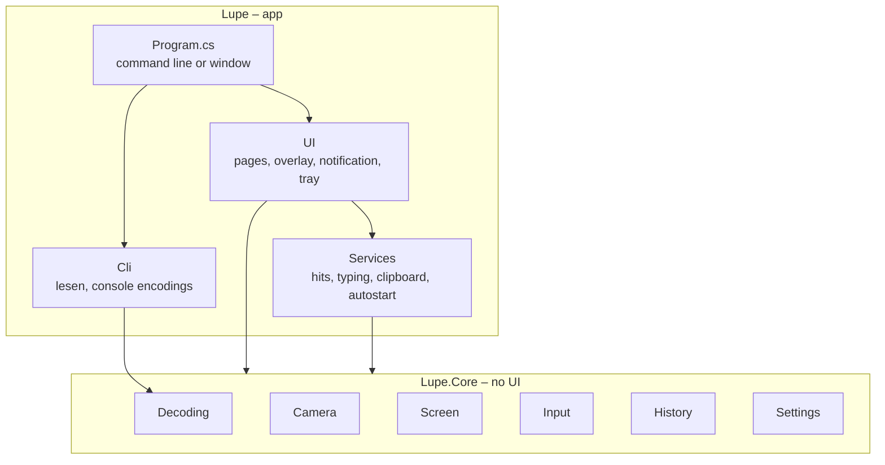

<sub><a href="../README.md">Lupe</a> › <a href="../README.md#documentation">Documentation</a> › Development</sub>

# Development

Building, testing and releasing Lupe, how the code is organised, and how the images in this documentation are made.

**Contents:** [Requirements](#requirements) · [Build](#build) · [Tests](#tests) · [Architecture](#architecture) · [MSI](#msi) · [CI and releases](#ci-and-releases) · [Screenshots and images](#screenshots-and-images) · [Demo and screenshot switches](#demo-and-screenshot-switches)

## Requirements

- **.NET 10 SDK.** `global.json` pins `10.0.100` with `rollForward: latestFeature`, so newer 10.0 feature bands work too.
- **Windows, Linux or macOS.** The app (`src/Lupe`, Avalonia) multi-targets `net10.0-windows10.0.19041.0` (with `Lupe.Platform.Windows`; the Windows SDK version for `Windows.Media.Capture`, minimum Windows 10 1809) and `net10.0` (with `Lupe.Platform.Linux` and `Lupe.Platform.MacOS`, chosen at run time). With a runtime identifier (`-r win-x64`, `-r linux-x64`, `-r osx-arm64`) only the matching target is built, so publish commands need no `-f`. `EnableWindowsTargeting` lets the Windows target compile elsewhere too. The full test set runs on Windows; the `net10.0` tests (core and the headless UI tests) run everywhere.
- For the MSI: nothing extra – the WiX Toolset comes as an MSBuild SDK (`WixToolset.Sdk` 5.0.2, plus `WixToolset.Util.wixext`) via NuGet.
- For the banner image: Node.js and Google Chrome (see [Screenshots and images](#screenshots-and-images)).

## Build

```powershell
dotnet build Lupe.sln
dotnet run --project src/Lupe -f net10.0-windows10.0.19041.0 -- --demo   # Windows: demo camera and sample history
dotnet run --project src/Lupe -f net10.0 -- --demo                       # Linux, macOS
dotnet run --project src/Lupe -f net10.0 -- --hilfe                      # command-line help
```

Release builds as the CI produces them:

```powershell
$common = 'src/Lupe/Lupe.csproj', '-c', 'Release', '-r', 'win-x64', '-p:PublishSingleFile=true', '-p:DebugType=none'
dotnet publish @common --self-contained false -o out/framework       # needs the .NET 10 Runtime
dotnet publish @common --self-contained true  -o out/self-contained  # basis of the MSI
dotnet publish @common --self-contained true -p:IncludeNativeLibrariesForSelfExtract=true `
               -p:EnableCompressionInSingleFile=true -o out/standalone  # the single Lupe.exe
```

The version comes from `<Version>` in `src/Lupe/Lupe.csproj` (currently `0.1.0`); the CI overrides it with `-p:Version=…`. Keep it at or above the newest release tag: set it to the version you are about to tag, and raise it afterwards for the next builds from `main`. If it stays below a released version, MSIs from `main` are refused on PCs that have that release installed, and the app shows the lower version.

## Tests

```powershell
dotnet test Lupe.sln
```

The xUnit project `tests/Lupe.Tests` has about 1,300 test cases. Tests that need something the machine may not have **skip themselves** with a reason instead of failing – check the skipped count before you trust a green run:

| Attribute | Runs only … | Skipped … |
|---|---|---|
| `[CameraFact]` | when Windows reports a video capture device (virtual cameras count) | without a camera – on the development machine and on CI |
| `[DesktopFact]` | when a screenshot of a test window really shows that window | in session 0 or without a usable desktop |
| `[InteractiveFact]` | in the visible window station on the active desktop – real `SendInput` and `RegisterHotKey` | on services and CI runners |
| `[GermanKeyboardFact]` | with the German keyboard layout (AltGr+Q = `@`) | with other layouts |
| `[CodecFact]` | when Windows has a working codec for the format (WebP, HEIC …) | without the Store extension, or with a registered but broken one |
| `[LeistungFact]` | timing tests with fixed limits | when `CI=true` (GitHub Actions) – runners are too uneven; force with `LUPE_LEISTUNG=1` |
| `[AppCoreFact]` | tests through the real `Lupe.exe` | when `Lupe.exe` has not been built |
| `[X11Fact]` | Linux with an X server and no Wayland – `XGetImage`, XTest typing into a test window, `XGrabKey` | elsewhere; run them with `xvfb-run` |
| `[WaylandFact]` | Linux in a Wayland session with a session bus and xdg-desktop-portal | elsewhere |

Counterparts such as `[NoDesktopFact]` and `[NonInteractiveFact]` check the behaviour **without** a desktop – that the core (`ScreenCapture.TryCapture`, `KeyboardTyper.TryType`, `GlobalHotkey`) reports a refused screenshot, refused input or a refused shortcut with the reason instead of failing silently. The app passes that reason on to the user.

On Linux, run the platform-neutral tests and the X11 tests under a virtual X server (packages `xvfb`, `libx11-6`,
`libxtst6`, `libxrandr2`):

```bash
xvfb-run -a -s "-screen 0 1280x1024x24" dotnet test tests/Lupe.Tests -f net10.0
```

The Wayland tests need a compositor and the portals, e.g. `sway` headless (`WLR_BACKENDS=headless`,
`WLR_RENDERER=pixman`) with `pipewire`, `xdg-desktop-portal`, `xdg-desktop-portal-wlr` and `xdg-desktop-portal-gtk`
inside `dbus-run-session`. Tests that change `LinuxSession.Environment` or talk to the X server share the collection
`Linux-Sitzung` and do not run in parallel.

The camera tests that run in real time (`Camera/ScanLoopRealtimeTests` and `Camera/FakeFrameSourceTests`: frame rate, repeat suppression) and the scan loop tests (`Camera/ScanLoopTests`, `Camera/ScanLoopReentrancyTests`) belong to the xUnit collection `Echtzeit`, which xUnit runs on its own after all parallel tests have finished. On runners with few cores, the other tests otherwise slowed recognition down so much that time windows were missed. The scan loop tests also depend on the thread pool: while the decoding tests filled it, timers (`Task.Delay`, the demo camera's frame clock) waited more than 10 s on the 3-core macOS runner.

Tests that occupy threads for a long time (a barrier, a loop until the test ends) use their own threads (`TestSupport/OwnThreads`) instead of `Parallel.For` or `Task.Run`, so they don't starve the thread pool shared by all tests.

| Tests | Check |
|---|---|
| `Decoding/*` | Round trip of all 22 formats (codes written with zxing-cpp); small, rotated, slanted, inverted, noisy and blurred codes, several per picture, hard codes next to easy ones, small codes in 4K screenshots; the new formats; GS1 group separator, ECI, Shift_JIS, binary content; contradicting reads and barcode fragments; phantom codes in busy pictures; native objects in long runs; image files in every format, truncated files, size limit |
| `Camera/*` | Scan loop with a simulated frame source – throttling, repeat suppression, start/stop from its own events, real-time behaviour; format choice, frame conversion, error classification, camera list |
| `Screen/*` | Monitors and virtual desktop in physical pixels, copying from an in-memory drawing surface, real screenshots of a test window (desktop only) |
| `Input/*` | Typing sequence against a simulated keyboard (batches, held keys, partial input), real typing into a Win32 text box (desktop only), shortcut registration against a simulated Windows API, AltGr protection, shortcut text in German and English, elevation check |
| `History/*`, `Settings/*` | Concurrency, broken and locked files, atomic writes, CSV format and injection protection, link-rule safety, tolerant loading and backups |
| `App/*` | The command line end to end through the real exe – image formats, several files, exit codes, redirection into files with umlauts and emoji, BOM handling, `.cmd` files waiting; window and demo behaviour; the screenshot switch |
| `Ui/*` | The Avalonia UI without a screen (`Avalonia.Headless` with Skia, any OS): page navigation with Ctrl+1…6, badges and notices, recording a shortcut in the settings, choosing one of several codes with the number keys, sorting the history, accent colours per theme, key-code mapping |

## Architecture



| Project / folder | Content |
|---|---|
| `src/Lupe.Core/Model` | `PixelImage` (BGRA picture shared by all parts), `DecodedCode`, `ResultActions`, `LinkRule`, `HistoryEntry`, `Hotkey`, `LupeSettings` with all defaults |
| `src/Lupe.Core/Decoding` | `BarcodeDecoder` (stages, tiles, result order), `LiveBarcodeDecoder` (camera), `FormatReaders` (format list, readers, two-line confirmation for barcodes), `MultiDecode`, `WindowSearch` (Data Matrix/Aztec away from the centre), `GrayImage`, `ImageFile` and `ImageIntegrity` (loading, truncated files) |
| `src/Lupe.Core/Platform` | Platform interfaces (`IPlatform` and its parts), `LupePlatform` (active platform), `UnsupportedPlatform` – see [architecture-platforms.md](architecture-platforms.md) |
| `src/Lupe.Core/Camera` | `Cameras` (list and open via the platform), `CameraList` (names), `FormatChooser`, `ScanLoop` (throttling), `RepeatFilter`, `FakeFrameSource` for tests and the demo |
| `src/Lupe.Core/Screen` | `ScreenCapture` (facade over the platform: monitors, capture), `PixelRect`, `MonitorArea` |
| `src/Lupe.Core/Input` | `KeyboardTyper` (event sequence, batching, pacing; output via `IKeyboardOutput`), `KeyEvent`, `HotkeyText` (display and parsing) |
| `src/Lupe.Platform.Windows` | `WindowsPlatform`: `Camera/` (`CaptureSession` with MediaCapture, `FrameConverter`, `CameraProblems`, `CameraPrivacy`), `Screen/` (GDI capture, `DpiScope`, `DisplayNames`), `Input/` (`WindowsKeyboard` with SendInput and waitable timer, `Elevation`, `GlobalHotkey`, `AltGr`), `Imaging/` (WIC decoder), registry autostart |
| `src/Lupe.Platform.Linux` | Linux backend (X11 and Wayland), see [platform-linux.md](platform-linux.md) |
| `src/Lupe.Platform.MacOS` | Skeleton that reports “nicht verfügbar” until the backend is implemented |
| `src/Lupe.Core/History` | `HistoryStore`, `HistoryFile` (JSON), `HistoryCsv` |
| `src/Lupe.Core/Settings` | `SettingsStore` (tolerant loading, normalising), `SettingsFile` (backup, merge of a locked file), `LinkRules`, `AtomicFile` |
| `src/Lupe` | Avalonia 12 app. `Program.cs` (entry point: picks the platform, command line without UI, the window, or headless screenshots), `App.axaml(.cs)` (window, tray, shortcut), `AppState` (shared state), `Cli/` (`CommandLine`, `ConsoleSession`), `UI/` (pages, `SelectionOverlay` – one window per monitor, `ResultToast`, `CodeChoiceWindow`, `AppTray`, `Dialogs`, `Theme/` – Windows 11 colours in the style of Zutritt and Vitrine, light/dark, Mica), `Services/` (`Hits` – the hit pipeline, `Desktop` – beep, clipboard, browser, typing, `Autostart`, `SingleInstance` – mutex on Windows, lock file and local socket elsewhere), `Demo/` (demo data, all codes generated with zxing-cpp), `Assets/LupeIcons.ttf` (Fluent UI System Icons subset on the Segoe Fluent Icons code points, used on Linux and macOS) |
| `installer/` | WiX 5 MSI |
| `tests/Lupe.Tests` | xUnit tests |
| `tools/screenshots` | Generator for the documentation images |
| `tools/icons` | `make-lupe-icons.py` builds `src/Lupe/Assets/LupeIcons.ttf` (fontTools): the Fluent UI System Icons Lupe uses, scaled to fill the em square and mapped to the Segoe Fluent Icons code points, so XAML keeps one set of glyph codes on every OS |

The only NuGet dependency of the core is `ZXingCpp` 0.5.3 (Apache-2.0): the .NET wrapper of zxing-cpp 3.1.1 with the native `ZXing.dll` / `libZXing.so` / `libZXing.dylib`, which also contains libzint and libzueci (BSD-3-Clause). **The packages do not ship the native libraries from the NuGet package**: those need glibc 2.38, macOS 26 (arm64) and the VC++ runtime. `packaging/zxing/build.sh <rid> <folder>` builds the same zxing-cpp version (tag and commit in `packaging/zxing/versions.env`, taken from the package's `.nuspec`) on old baselines – Linux in the `manylinux_2_28` container (glibc 2.28), macOS with deployment target 12.0, Windows with the static runtime (`/MT`) – and `dotnet publish … -p:LupeZXingDir=<folder>` puts them in place of the package's ones. Local builds and the tests keep the NuGet libraries. When you update `ZXingCpp`, update `versions.env` too; `packaging/zxing/check.sh` fails otherwise. If the native library does not load, Lupe reports error `LUP-0001` ([error codes](error-codes.md)) instead of finding nothing. A publish for `win-x64` puts `ZXing.dll` next to `Lupe.exe`; the single-file `Lupe.exe` carries it inside and extracts it on first start (`IncludeNativeLibrariesForSelfExtract`). Licence texts of all third-party components: [`THIRD-PARTY-NOTICES.txt`](../THIRD-PARTY-NOTICES.txt) – copied next to `Lupe.exe` and embedded for the *Info* page; update it together with the package. Code comments and some identifiers are in German; user-facing text is in the resource files (next section).

## Languages

Following ICT-Baden guideline 13 (multilingual UI), no user-visible text is hard-coded:

- `src/Lupe.Core/Resources/Strings.resx` holds the English texts (neutral and fallback language), `Strings.de.resx` the German ones. The build generates the class `Lupe.Core.Resources.Strings` (no designer file in the repository); XAML uses `{x:Static l:Strings.Key}` with `xmlns:l="clr-namespace:Lupe.Core.Resources;assembly=Lupe.Core"`.
- Keys are prefixed by area: `Core_`, `Win_`, `Linux_`, `Mac_`, `Page_`, `App_`. Texts with values use numbered placeholders (`string.Format(Strings.Key, …)`), never glued pieces; plurals use `_One`/`_Other` keys.
- `UiLanguage.Apply` sets the UI culture at the very start of `Main`: the environment variable `LUPE_LANGUAGE`, then the setting `Language` (*Settings › Language*, `""` = system), then the system language; anything without its own file falls back to English. Number and date formats follow the system's regional settings.
- Trace/log messages, comments, command-line keywords (`lesen`, `--hilfe`, `hell|dunkel|beide`) and file names stay German.
- The tests run in German (`tests/Lupe.Tests/TestCulture.cs`, also sets `LUPE_LANGUAGE=de` for child processes). `LocalizationTests` checks that every language has the same keys and placeholders as English and no empty texts.
- Adding a language: add `Strings.<code>.resx`, the code to `UiLanguage.Supported` and to `SatelliteResourceLanguages` in `Directory.Build.props`. `LocalizationTests` checks that every language file has the same keys and placeholders as `Strings.resx` and no empty texts. es, fr and zh-Hans are machine-translated and not yet reviewed by native speakers (see the comment at the top of each file).

## MSI

```powershell
dotnet publish src/Lupe/Lupe.csproj -c Release -r win-x64 -p:PublishSingleFile=true --self-contained true -o publish
dotnet build installer/Lupe.Installer.wixproj -c Release -p:ProductVersion=0.1.0
```

`installer/Package.wxs` installs everything from the publish folder (without `.pdb`) per machine into `C:\Program Files\Lupe`, adds a Start menu shortcut (its key path is the value `StartMenuShortcut` under `HKLM\SOFTWARE\ICT-Baden\Lupe`), closes a running `Lupe.exe`, and sets `MajorUpgrade` with `AllowSameVersionUpgrades` so that CI builds – which differ only in the fourth version part – replace each other. It sets no autostart; that is a per-user setting inside the app. The UI culture of the package is `de-DE`. ICE38, 43, 57, 60 and 61 are suppressed with reasons in the project file; validation is skipped on CI.

## CI and releases

`.github/workflows/build.yml` runs for pushes to `main`, tags `v*`, pull requests and manual starts. The workflow token only reads; `release` gets `contents: write`, `windows` `id-token: write` for the signing login. `AVALONIA_TELEMETRY_OPTOUT=1` switches off Avalonia's build telemetry (set it locally too if you like). Jobs:

0. **`zxing-linux`**, **`zxing-macos`**, **`zxing-windows`** (`ubuntu-latest` and `ubuntu-24.04-arm`, `macos-latest`, `windows-latest`; separate jobs so that Windows and Linux do not wait for a free macOS runner): build the native zxing-cpp library per platform with `packaging/zxing/build.sh` – cached, rebuilt only when `build.sh` or `versions.env` change – and check it every run with `packaging/zxing/check.sh` (glibc at most 2.31 and libstdc++ at most GCC 10, `minos` at most `LSMinimumSystemVersion`, no `VCRUNTIME`/`MSVCP` imports and a fully static CRT, the C functions the wrapper needs, versions consistent).

1. **`version`** (Ubuntu): a tag `v1.2.3` gives `1.2.3`; otherwise the csproj version plus the run number, e.g. `0.1.0-ci.12`. The MSI gets `0.1.0.12` (numbers only). Files carry the version in their names only for tags (`Lupe-1.2.3-x64.msi`, `Lupe-1.2.3-linux-x64.tar.gz`, `lupe_1.2.3_amd64.deb`); builds from `main` use fixed names so that download links stay valid. `Lupe.exe` is always called that.
2. **`windows`** (`windows-latest`): restore, build and test the whole solution (both test TFMs), publish the three Windows variants with the self-built `ZXing.dll` (signed first when signing is set up), package the ZIP (with the README) and the single exe, build the MSI from the self-contained output. Then `packaging/check-natives.sh` checks that no shipped DLL needs the VC++ runtime, `packaging/check-notices.py` that every shipped library is in `THIRD-PARTY-NOTICES.txt`, `packaging/smoke.sh` reads `packaging/smoke-qr.png` with all three variants, and the MSI is installed, smoke-tested and uninstalled on the runner. Signing with Azure Artifact Signing (the exes before packing, then the MSI) runs only once the organisation variable `SIGNING_ACCOUNT` is set, and never for pull requests; until then the builds are unsigned (ICT-Baden guideline 05).
3. **`linux`** (`ubuntu-latest`): build and test `net10.0` under `xvfb-run` (so the X11 tests run), publish self-contained for `linux-x64` and `linux-arm64`, then `packaging/linux/package.sh` builds `Lupe-linux-<arch>.tar.gz` (folder `lupe/` with `lupe.desktop`, icon, `install.sh`, `LIESMICH.txt`) and, for x64, `lupe_amd64.deb` with `dpkg-deb` (package name `ictbaden-lupe` after the ICT-Baden naming rules, replaces the former package `lupe`; `/opt/lupe`, `/usr/bin/lupe`, menu entry; the version `0.1.0-ci.12` becomes `0.1.0~ci.12`). Checks: `Depends` contains `libc6 (>= …)` computed from the shipped libraries, every native file passes `check-natives.sh` and the notices check, and `smoke.sh` reads a code with the `.deb` on Ubuntu 22.04 and with the tarball on Ubuntu 20.04 (glibc 2.31) and Debian 12 in Docker. The job also writes `Lupe-sbom.cdx.json` (CycloneDX 1.5, `packaging/sbom.py`) over the packages of all platforms. **`linux-arm64-rauchtest`** (`ubuntu-24.04-arm`) runs the same tarball smoke test for arm64.
4. **`macos`** (`macos-latest`, Apple Silicon): build and test `net10.0` (including the macOS-only tests), publish self-contained for `osx-arm64` and `osx-x64`, then `packaging/macos/package.sh` builds `Lupe.app` (`Info.plist` with `NSCameraUsageDescription`, icon made with `sips`/`iconutil`, ad-hoc `codesign`) and zips it with `ditto` as `Lupe-macos-<arch>.zip`. Both bundles are checked (`codesign --verify`, every Mach-O at most `LSMinimumSystemVersion`, notices) and read a code with `smoke.sh` (x64 under Rosetta). **Developer ID and notarisation** are prepared: with the secrets `MACOS_CERTIFICATE_P12` (base64 of the `.p12`), `MACOS_CERTIFICATE_PASSWORD`, `MACOS_SIGN_IDENTITY` (`Developer ID Application: …`) and, for notarisation, `MACOS_NOTARY_APPLE_ID`, `MACOS_NOTARY_TEAM_ID`, `MACOS_NOTARY_PASSWORD` (app-specific password), the job imports the certificate into a temporary keychain and `package.sh` signs every file with the hardened runtime (`packaging/macos/Lupe.entitlements`: JIT, camera), submits the app with `notarytool`, staples the ticket and checks it with `spctl`. Without the secrets – and always for pull requests – it signs ad hoc as before.

Test results of each job are uploaded as `.trx` (`Testergebnisse-<os>`), packages as `Pakete-<os>`. Camera, desktop and timing tests skip themselves on the runners.

5. **`release`** (Ubuntu, after the three build jobs, not for pull requests): collects all packages and writes `SHA256SUMS.txt` over them. A tag creates a release *Lupe v…* with generated notes – a tag with a hyphen (`v1.0.0-rc1`) as a pre-release. A push to `main`, or a manual start on `main`, updates the release **latest** in place with `.github/scripts/release-latest.ps1`; `-Expected` lists the ten files (`SHA256SUMS.txt`, `Lupe-x64.msi`, `Lupe.exe`, `Lupe-win-x64-framework.zip`, `lupe_amd64.deb`, `Lupe-linux-x64.tar.gz`, `Lupe-linux-arm64.tar.gz`, `Lupe-macos-arm64.zip`, `Lupe-macos-x64.zip`, `Lupe-sbom.cdx.json`), and the script stops before changing anything if one is missing. As long as there is no release from a tag, **latest** is a regular release marked *Latest* – GitHub does not list pre-releases in the repository sidebar; once a tag release exists, **latest** becomes a pre-release and the tag release keeps that place. The update itself: all new files are uploaded under temporary names first; only when all of them are there does the tag `latest` move to the new commit and each file replace its old namesake (delete, then rename – retried on errors). Files the new build no longer has are removed, the title shows the version, and the release is set to draft and published again right away – otherwise GitHub would keep showing the date of the very first build. If an upload fails, the files under the fixed names stay untouched (temporary `neu-…` files may remain until the next run). Only commits on `main` are published, never one older than what `latest` already shows – a re-run of an older run changes nothing (this applies to runs made with this script; runs up to build 8 still deleted and recreated the release). If `main` has moved on in the meantime with changes to workflow files, the run leaves publishing to the following run, because GitHub does not let the Actions token point a release at a commit whose workflows differ from `main`.

Runs on the same branch are queued, so `latest` releases do not overtake each other. GitHub keeps only the newest waiting run of a branch and cancels the ones in between. To publish the current head of `main` again, re-run its newest run or start the workflow manually on `main`.

## Screenshots and images

All images under `docs/assets` are generated:

```powershell
cd tools\screenshots
npm install            # playwright-core, for the banner
.\make-assets.ps1
```

The script

1. builds Lupe (Release) and runs `Lupe.exe --screenshots <temp>`: every page of the demo, light and dark, with the window at 1100 × 740 and 1.5× scale (1650 × 1110 pixels), plus the selection overlay over a demo desktop (1600 × 900) and the result notification – drawn without a screen (Avalonia.Headless with Skia), so no visible desktop is needed, also on Linux without an X server. The accent colour is fixed to the Windows default blue, and Mica and the notification's shadow are left out. The German file names are mapped to the English ones used here (`kamera` → `camera`, `bildschirm` → `screen`, `auswahl` → `selection`, `treffer` → `result`, `datei` → `file`, `verlauf` → `history`, `einstellungen` → `settings`, `info` → `about`);
2. renders `banner.html` to `banner.png` (2560 × 840) with the installed Google Chrome through playwright-core (`CHROME_PATH` for another browser). The banner uses `file-light.png` from step 1.

The screenshots use fixed data: a fixed time (14 October 2026, 10:42; `--demo` uses the current time), links only to reserved example domains (`example.org`, `example.com`, `.example`), and codes generated by zxing-cpp – the codes in the screenshots are real and readable.

## Demo and screenshot switches

```text
Lupe.exe --demo
Lupe.exe --screenshots <folder> [--theme hell|dunkel|beide]
```

- `--demo` – the window with a demo camera (a simulated frame source showing a delivery label, an EAN and a type plate in turn), a sample history of twelve entries and sample settings (screen scan copies and types, three link rules – one of them inactive). Nothing is saved, no global shortcut is registered (it would collide with a running Lupe), no notification-area icon; autostart is not available.
- `--screenshots` – see above; errors end with exit code 3 and are printed to the console, so an incomplete image set never goes unnoticed.

Both are listed in `--hilfe` as well; details in [Command line › Start switches](command-line.md#start-switches).

---

<p align="center"><sub>
<a href="installation.md">Installation</a> · <a href="usage.md">Using the app</a> · <a href="settings.md">Settings</a> · <a href="link-rules.md">Link rules</a> · <a href="command-line.md">Command line</a> · <a href="how-it-works.md">How it works</a> · <a href="data-and-privacy.md">Data &amp; privacy</a> · <a href="limitations.md">Limitations</a> · <b>Development</b><br>
<a href="../README.md">← Back to Lupe</a>
</sub></p>
