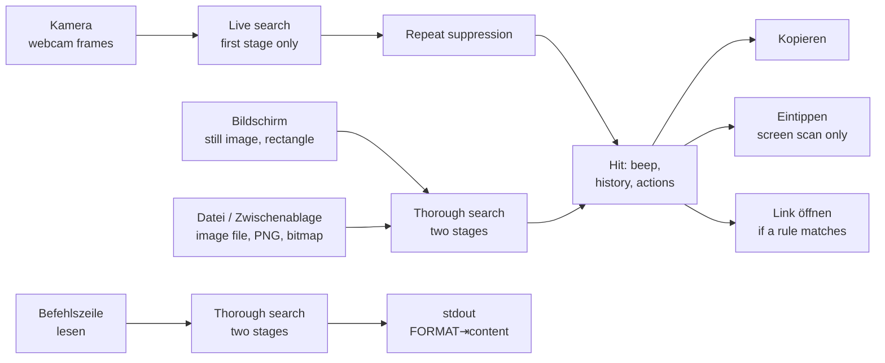

<a href="../README.md">Lupe</a> › <a href="../README.md#documentation">Documentation</a> › How it works

# How it works

What happens between a picture and a result: how Lupe gets images from the camera, the screen and files, how it searches them for codes, how it avoids phantom codes, and how it types into other programs.

**Contents:** [The path of a code](#the-path-of-a-code) · [Decoding](#decoding) · [Live vs. thorough](#live-vs-thorough) · [Phantom-code protection](#phantom-code-protection) · [Image files](#image-files) · [Screen capture](#screen-capture) · [Typing](#typing) · [Global shortcut](#global-shortcut) · [Camera](#camera)

## The path of a code

Every source ends up as the same thing – a picture of 32-bit pixels – and goes through the same decoder ([ZXing.Net](https://github.com/micjahn/ZXing.Net) 0.16.11 with Lupe's own search around it). The camera uses a lighter variant of it. For a hit in the app, Lupe beeps (*Ton bei Treffer*), adds every code to the history and runs the actions for one code – the only one, or the one you choose after a screen scan – in a fixed order: copy, type, open the link last, because the browser takes the focus. The command line only prints.

## Decoding

The picture is converted to grey once and then searched in **stages**. Each stage consists of tasks – a version of the picture × normal or inverted × a group of readers – that run in parallel on all cores. Every reader group binarises the picture itself, so that one group's difficulties do not cost the others their result.

| Reader groups | Formats |
|---|---|
| 2D | QR Code, Data Matrix, Aztec, MaxiCode · PDF417 (own group) |
| 1D | EAN/UPC · Code 128 and ITF · Code 39 · Code 93 and Codabar · GS1 DataBar and DataBar Expanded · Intelligent Mail |

**Stage 1 – always:**

- **The whole picture**, with a white border of about 5 % of the longer side (8 to 48 pixels), so that codes reaching the edge still have their quiet zone.
- **Large pictures** – above 4.2 megapixels, for example a 4K screenshot – are searched instead as an **overview** reduced to about 2.1 megapixels **plus overlapping tiles** of 1024 pixels in full resolution, overlapping by 320 pixels so that a code up to that size lies completely in one tile. Pictures above 12 megapixels are reduced before tiling, and there are at most 48 tiles. This is how small codes in big screenshots are found.
- **Inverted** – light codes on dark backgrounds, common in dark mode and on displays – for the 2D formats.
- **Several codes:** after a hit, the search continues left, right, above and below it. QR codes additionally go through ZXing's multi-QR reader, which separates codes that sit close together.
- **Data Matrix and Aztec away from the centre:** ZXing's detectors for these two start in the middle of the picture and miss a code elsewhere in a busy picture. Lupe looks for areas with dense structure in both directions – many light/dark transitions horizontally and vertically – and reads a window around each candidate, at most 48 per picture.

**Stage 2 – only if stage 1 found nothing** (or only a weak barcode fragment, see below):

- 1D formats **inverted**.
- Small pictures **enlarged** ×2 (longer side up to 1000 pixels) and ×3 (up to 400 pixels) – for codes with only one or two pixels per module.
- Medium pictures **halved** – smooths noise and blur.
- **Rotated** in 10° steps up to ±40° for Aztec, PDF417 and Data Matrix; barcodes only at exactly ±30° (their own 90° check covers the rest). ZXing's Aztec and PDF417 detectors tolerate only a few degrees, and barcodes whose bars no image row crosses completely are otherwise not read. QR codes need no rotation. Rotated versions are reduced to about 2.4 megapixels first.

**The result** contains each content once per format, in reading order: codes whose heights overlap form a row, read left to right, rows top to bottom. Each code keeps its corner points for the outline – the four outer corners for QR codes and PDF417, the two ends of the reading line for barcodes.

**Text encoding repair.** For byte content without a character-set marker, ZXing.Net under .NET sometimes takes ISO-8859-1 text for Shift_JIS and turns umlauts into `�` – “Groß” becomes “Gro�”. Lupe re-reads such a segment as ISO-8859-1, the default for QR codes without a marker. Real Shift_JIS content is not helped by this – see [Limitations](limitations.md#decoding).

## Live vs. thorough

| | Camera | Screen scan, file, clipboard, command line |
|---|---|---|
| Stages | stage 1 only | stage 1 and, if needed, stage 2 |
| Parallel tasks | a quarter of the cores, at least 1, at most 2 | all cores |
| Why | the next frame is a new chance anyway, and the PC should not run under permanent full load | one picture, as thorough as possible |

On the camera, Lupe never runs more than one search at a time and keeps no queue: frames that arrive while a search runs are shown in the preview but not searched.

## Phantom-code protection

Barcode readers sometimes “find” a valid-looking code in noise, text or a slanted view of another code. Lupe works against that in several places:

- **Excluded formats.** MSI and Pharmacode are not read at all: their readers produce phantom codes (e.g. “000”) in almost every screenshot, camera picture and noise, and slowed the search down by up to 30 times. Plessey cannot be read by ZXing.Net.
- **Two lines for barcodes.** A 1D code only counts once the same content has been read on at least two image rows. A single slanted row otherwise produces an occasional code with a matching check digit – typically an EAN-8 or UPC-E in the middle of another barcode.
- **Fragments are removed.** ITF has no check digit, EAN-8 and UPC-E only one. A code of these “weak” formats is dropped if its content is part of a longer barcode at the same place – e.g. a phantom EAN-8 `60002914` from a UPC-A `036000291452`. A weak hit alone also does not stop stage 2.
- **GS1 DataBar Expanded only in one row.** ZXing's stacked mode combines rows from anywhere in the picture until a checksum happens to fit – measured during development in about one in a hundred busy screenshots and one in ten noisy camera pictures, sometimes with empty content.
- **Empty contents are discarded.** A hit without text is a phantom and useless to anyone.
- **Faults in a reader cost only that reader's result.** ZXing occasionally throws on broken data; that counts as “nothing found” for this task, not as an error of the scan.

## Image files

Files and clipboard images are loaded through `Windows.Graphics.Imaging`:

- **Formats:** PNG, JPEG, BMP, GIF, TIFF, ICO and JPEG XR are always there. WebP, HEIC/HEIF, AVIF and JPEG XL need the matching image extension from the Microsoft Store; without it Lupe names the missing codec (*Für WEBP fehlt Windows der passende Codec …*). The open dialog offers what Windows can decode on this PC.
- **Orientation and colour:** the EXIF rotation of photos is applied, colours are converted to sRGB (without colour management if a profile is broken).
- **Transparency** is flattened onto white, so a black code on a transparent PNG stays readable.
- **Several frames:** GIF and TIFF – the first; ICO – the largest.
- **Incomplete files:** Windows reads a truncated PNG, JPEG or GIF without complaint and fills the rest grey or white – Lupe would then report “no code” for a broken file. Lupe checks the structure first (PNG up to its end block, JPEG up to its end marker across all scans, GIF up to the end of the first image) and reports *… ist unvollständig – die Datei endet mitten im Bild (abgebrochener Download oder Kopiervorgang?)*.
- **Size limit:** pictures above **40 megapixels** are reduced to 40 megapixels while loading (about 160 MB in memory) instead of failing.
- **Clipboard:** an image file copied in Explorer is read as a file; otherwise the PNG data that browsers, Office and the Snipping Tool put on the clipboard (lossless, with transparency); otherwise the clipboard bitmap.

## Screen capture

1. **Get out of the way.** Lupe hides its own window – without the fade animation, which would otherwise end up half-transparent in the still image – and closes an open result notification. It waits until Windows has really removed them from the screen.
2. **Capture.** One still image of the whole virtual desktop – all monitors – is copied with GDI (`BitBlt` with `CAPTUREBLT`). All coordinates are **physical pixels**: the capturing thread switches to per-monitor DPI awareness (v2), regardless of scaling, so nothing is blurred or shifted on monitors with 125 %, 150 % or mixed scaling. Areas outside all monitors stay black. If Windows refuses the capture – locked desktop, sign-in screen, no visible session – Lupe stops here and says why (*Bildschirm-Scan nicht möglich*).
3. **Select.** The overlay is a single window across the virtual desktop, placed in physical pixels; its content is scaled so that every pixel of the still image lies exactly on its screen pixel, also with different scaling per monitor. A click without dragging (less than 4 pixels of movement) selects the monitor under the pointer.
4. **Search** the selected part of the still image – not the live screen – with the thorough search.
5. **Report** in the result notification at the bottom right of the monitor where the rectangle was – or in the message bar of the Lupe window, if a Lupe window was in front when the scan started (the button, the notification-area menu, or the shortcut pressed inside Lupe) and the main window is open and not minimised.

## Typing

*Eintippen* sends the content as keyboard input (`SendInput`) to the window that was in front before the scan:

- **Unicode, layout-independent.** Every character goes out as a Unicode keystroke, not as a key of the current keyboard layout – umlauts, `€`, `@` and emoji arrive as they are, also with a US layout. Characters outside the basic plane (emoji) are sent as one surrogate pair.
- **Line breaks and tabs** (`\r\n`, `\n`, `\r`, U+0085, U+2028, U+2029) become the <kbd>Enter</kbd> key, tabs the <kbd>Tab</kbd> key. **Other control characters cannot be typed and are dropped** – for example the group separator (GS, `0x1D`) in GS1 codes.
- **Wait until the keys are released.** Before typing, Lupe waits until no key is pressed any more – otherwise “a” with a still-held <kbd>Ctrl</kbd> from the shortcut would become <kbd>Ctrl</kbd>+<kbd>A</kbd>. Modifier keys still held after 1.5 seconds are released artificially for the typing; for <kbd>Alt</kbd> and <kbd>Win</kbd> an unused key is pressed first so that releasing them does not open a menu or the Start menu.
- **In portions.** Long texts are sent in packets of about 200 characters with a short pause in between, so that the target program keeps up. Two typing jobs never interleave.
- **Activate first, then type.** Lupe brings the previous window to the front and types only once it really is in front. If it no longer exists or cannot be activated, nothing is typed (*Das Fenster von vorher ließ sich nicht aktivieren – nichts eingetippt.*).
- **Elevated windows.** If the window in front runs with a higher integrity level than Lupe (as administrator), Windows silently discards the input (User Interface Privilege Isolation) – `SendInput` would even report success. Lupe compares the integrity levels beforehand, types nothing and reports it (*Eintippen nicht möglich – das Fenster im Vordergrund läuft mit höheren Rechten als Lupe (z. B. als Administrator) …*); the result does not count as typed.
- **Partial input.** If Windows stops accepting input midway, Lupe releases any key it left pressed, stops and reports it (*Eintippen wurde unterbrochen – der Text kam nur teilweise an.*).

Afterwards, the key from *Nach dem Eintippen* (<kbd>Enter</kbd> or <kbd>Tab</kbd>) is sent.

## Global shortcut

The shortcut is registered with `RegisterHotKey` on a separate thread with its own message window, so it works with the Lupe window hidden. Holding the keys triggers only once (no auto-repeat). While a scan is running – the overlay is open – a second press is ignored. While you record a new shortcut in the settings, the old one is unregistered.

**AltGr protection.** Windows reports <kbd>AltGr</kbd> as <kbd>Ctrl</kbd>+<kbd>Alt</kbd>. For a shortcut with <kbd>Ctrl</kbd>+<kbd>Alt</kbd> but without <kbd>Win</kbd>, Lupe checks on every press whether the right <kbd>Alt</kbd> key is down and whether the keyboard layout of the window in front produces a character for <kbd>AltGr</kbd> plus that key. If so, Lupe types that character instead of starting a scan – <kbd>AltGr</kbd>+<kbd>Q</kbd> still gives `@` on a German keyboard. The default <kbd>Win</kbd>+<kbd>Shift</kbd>+<kbd>Q</kbd> is not affected.

## Camera

- **Which cameras:** all camera groups of `Windows.Media.Capture` with a colour video stream; the same camera appearing in several groups (e.g. together with an infrared sensor for Windows Hello) is listed once, identical models get “(1)”, “(2)”.
- **Opening:** first with exclusive control, so that Lupe can choose the format; if that fails – typically because another program uses the camera – once more in shared read-only mode with the camera's current format.
- **Format:** Lupe prefers about 1280 × 720 at 24 to 30 frames per second, uncompressed (NV12, YUY2) before MJPG, and avoids H.264 and similar. Larger formats cost time without helping the search; much smaller ones lose small codes. Frames are delivered as BGRA and reduced to at most 1280 × 720.
- **Frames:** a frame that arrives while the previous one is still being converted is dropped. The preview shows every converted frame; the search takes one at a time (see [Live vs. thorough](#live-vs-thorough)).
- **Repeat suppression:** per content and format, counted from the **last** sighting – a code in view keeps its suppression alive. It starts afresh every time the camera starts.
- **Failures:** unplugged, taken over by another program, blocked by the privacy settings, missing media features, or 30 frames in a row that cannot be converted – each is reported once with a German message that says what to do; the camera then stops. The privacy switches are read from the registry to name the exact one ([list](installation.md#camera-access-in-windows)).

---

<a href="installation.md">Installation</a> · <a href="usage.md">Using the app</a> · <a href="settings.md">Settings</a> · <a href="link-rules.md">Link rules</a> · <a href="command-line.md">Command line</a> · <b>How it works</b> · <a href="data-and-privacy.md">Data &amp; privacy</a> · <a href="limitations.md">Limitations</a> · <a href="development.md">Development</a> 
<a href="../README.md">← Back to Lupe</a>

