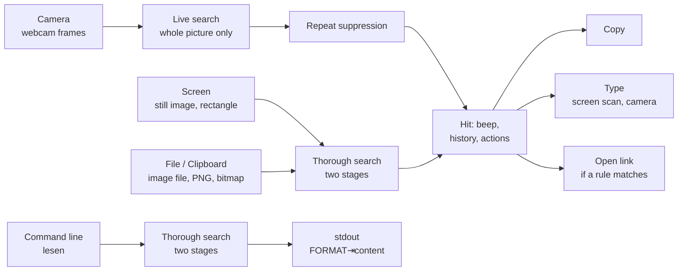

<a href="../README.md">Lupe</a> › <a href="../README.md#documentation">Documentation</a> › How it works

# How it works

What happens between a picture and a result: how Lupe gets images from the camera, the screen and files, how it searches them for codes, how it avoids phantom codes, and how it types into other programs.

**Contents:** [The path of a code](#the-path-of-a-code) · [Decoding](#decoding) · [Live vs. thorough](#live-vs-thorough) · [Phantom-code protection](#phantom-code-protection) · [Image files](#image-files) · [Screen capture](#screen-capture) · [Typing](#typing) · [Global shortcut](#global-shortcut) · [Camera](#camera)

## The path of a code

Every source ends up as the same thing – a picture of 32-bit pixels – and goes through the same decoder ([zxing-cpp](https://github.com/zxing-cpp/zxing-cpp) 3.1.1 with Lupe's own search around it). The camera uses a lighter variant of it. For a hit in the app, Lupe beeps (*Sound on detection*), adds every code to the history and runs the actions for one code – the only one, or the one you choose after a screen scan – in a fixed order: copy, type, open the link last, because the browser takes the focus. The command line only prints.

## Decoding

The picture is converted to grey once and then handed to zxing-cpp, a native library (`ZXing.dll`). zxing-cpp by itself finds several codes per picture, codes in every 90° position, light QR, Data Matrix and Aztec codes on dark backgrounds, and large codes in reduced versions of the picture. Lupe only adds what measurements during the switch to zxing-cpp showed to help – the unit tests and a benchmark of 1,345 pictures with 1,357 known codes (zxing-cpp's own sample photos and generated screenshots, camera frames and documents).

Each version of the picture is read in five **reading groups** in parallel – QR family (QR, Micro QR, rMQR) · Data Matrix · Aztec · PDF417 family and MaxiCode · barcodes – so that no single read takes long: a cancelled search waits at most for the longest one (about 0.3 s for a noisy 4K picture).

**Stage 1 – always:**

- **The whole picture** in full resolution.
- **Inverted** for the formats zxing-cpp does not invert itself: barcodes, PDF417 and MaxiCode – a light barcode on a dark background, common in dark mode.
- **Slanted barcodes and PDF417.** zxing-cpp reads QR, Data Matrix and Aztec at any angle, but a long barcode only up to about ±14° and PDF417 only up to about ±6°. Lupe therefore also reads the picture rotated by ±20° and ±40° (barcodes and PDF417) and ±10° and ±30° (PDF417 only); rotated versions are reduced to about 2.4 megapixels first. Together with zxing-cpp's own 90° check this covers every angle.
- **Very large pictures** – above 9 megapixels, for example a 24-megapixel photo – are read as an **overview** reduced to about 4 megapixels **plus overlapping tiles** of 2048 pixels in full resolution, overlapping by 512 pixels, at most 32 tiles. A 4K screenshot (8.3 megapixels) is read in one piece.

**Stage 2 – only if stage 1 found nothing reliable:** small pictures (longer side up to 1000 pixels, typically a screen region) **enlarged** ×2 – for codes with only one or two pixels per module. “Reliable” means any 2D code, or a barcode read on a band of at least 3 % of its length; a barcode read on only two or three rows of a blurry photo is often misread, and the enlarged version reads it correctly.

All of this runs every time – a hard code next to an easy one is no longer missed because the easy one was found first. With the earlier library, Lupe searched slanted, inverted and enlarged versions only when nothing at all had been found.

| Benchmark (1,357 codes) | Found |
|---|---|
| Earlier version (ZXing.Net) | 929 (68 %) |
| zxing-cpp, whole picture only | 1,220 (90 %) |
| + inverted | 1,223 |
| + slanted | 1,229 |
| + enlarged small pictures (stage 2) | 1,250 (92 %) |

**The result** contains each content once per format, in reading order: codes whose heights overlap form a row, read left to right, rows top to bottom (for barcodes the band of rows zxing-cpp read counts, not just the reading line). Each code keeps its points for the outline – the four corners for 2D codes, the two ends of the reading line for barcodes.

**Text.** zxing-cpp decodes byte content by its ECI marker or, without one, by recognising UTF-8, ISO-8859-1 and Shift_JIS. The group separator of GS1 codes (`\x1D`) stays in the text. Lupe keeps the text of its earlier versions where zxing-cpp would show it differently: UPC-A with 12 digits and UPC-E with 8 (zxing-cpp normalises both to the 13-digit GTIN), Codabar without its start and stop characters, GS1 DataBar as the 14-digit GTIN without `01`, GS1 DataBar Expanded in brackets (`(01)…(3103)…`).

## Live vs. thorough

| | Camera | Screen scan, file, clipboard, command line |
|---|---|---|
| What | the whole picture: 2D codes and barcodes as two reads, inverted only PDF417 and MaxiCode | everything above, including slanted and enlarged versions |
| Parallel tasks | a quarter of the cores, at least 1, at most 2 | all cores |
| Time (this PC) | about 20 ms for a 720p camera frame, 35 ms for a busy one | Full HD screenshot about 50 ms, 4K about 0.15 s |
| Why | the next frame is a new chance anyway, and the PC should not run under permanent full load | one picture, as thorough as possible |

On the camera, Lupe never runs more than one search at a time and keeps no queue: frames that arrive while a search runs are shown in the preview but not searched.

## Phantom-code protection

Barcode readers sometimes “find” a valid-looking code in noise, text or a slanted view of another code. The benchmark's 58 pictures without any code and the unit tests' busy screenshots and noisy camera pictures produce no phantom codes. Lupe works against them in several places:

- **Excluded formats.** MSI and Pharmacode are not read: their readers produced phantom codes in almost every screenshot. Code 39 Full ASCII and Code 32 are not interpreted – they would silently change ordinary Code 39 content (`S/N1` would become `S.1`).
- **Two lines for barcodes.** zxing-cpp only accepts a barcode once the same content has been read on at least two rows.
- **Contradictions at the same place.** When a rotated or reduced version reads a code differently than another version at the same place – a PDF417 cut at an angle whose rows end up shuffled but just pass the error correction, or an EAN-8 made from part of a UPC-A – the more reliable read wins: the one with more unused error correction (2D codes), the one read on more rows (barcodes), otherwise the one from the whole picture.
- **Fragments are removed.** ITF has no check digit, EAN-8 and UPC-E only one. A code of these “weak” formats is dropped if it lies inside another barcode, or if its content is part of a longer barcode right next to it – e.g. a short ITF from the lower rows of a slanted long one. A barcode read on only a few rows at the edge of the same kind of code, with different content, is dropped as well.
- **Faults in a read cost only that read's result.** If zxing-cpp reports an error, that counts as “nothing found” for this task, not as an error of the scan.

## Image files

Files and clipboard images are loaded through `Windows.Graphics.Imaging`:

- **Formats:** PNG, JPEG, BMP, GIF, TIFF, ICO and JPEG XR are always there. WebP, HEIC/HEIF, AVIF and JPEG XL need the matching image extension from the Microsoft Store; without it Lupe names the missing codec (*… Windows lacks the codec for WEBP …*). The open dialog offers what Windows can decode on this PC.
- **Orientation and colour:** the EXIF rotation of photos is applied, colours are converted to sRGB (without colour management if a profile is broken).
- **Transparency** is flattened onto white, so a black code on a transparent PNG stays readable.
- **Several frames:** GIF and TIFF – the first; ICO – the largest.
- **Incomplete files:** Windows reads a truncated PNG, JPEG or GIF without complaint and fills the rest grey or white – Lupe would then report “no code” for a broken file. Lupe checks the structure first (PNG up to its end block, JPEG up to its end marker across all scans, GIF up to the end of the first image) and reports *… is incomplete – the file ends in the middle of the image (interrupted download or copy?).*
- **Size limit:** pictures above **40 megapixels** are reduced to 40 megapixels while loading (about 160 MB in memory) instead of failing.
- **Clipboard:** an image file copied in Explorer is read as a file; otherwise the PNG data that browsers, Office and the Snipping Tool put on the clipboard (lossless, with transparency); otherwise the clipboard bitmap.

## Screen capture

1. **Get out of the way.** Lupe hides its own window – without the fade animation, which would otherwise end up half-transparent in the still image – and closes an open result notification. It waits until Windows has really removed them from the screen.
2. **Capture.** One still image of the whole virtual desktop – all monitors – is copied with GDI (`BitBlt` with `CAPTUREBLT`). All coordinates are **physical pixels**: the capturing thread switches to per-monitor DPI awareness (v2), regardless of scaling, so nothing is blurred or shifted on monitors with 125 %, 150 % or mixed scaling. Areas outside all monitors stay black. If Windows refuses the capture – locked desktop, sign-in screen, no visible session – Lupe stops here and says why (*Screen scan not possible*).
3. **Select.** The overlay is a single window across the virtual desktop, placed in physical pixels; its content is scaled so that every pixel of the still image lies exactly on its screen pixel, also with different scaling per monitor. A click without dragging (less than 4 pixels of movement) selects the monitor under the pointer.
4. **Search** the selected part of the still image – not the live screen – with the thorough search.
5. **Report** in the result notification at the bottom right of the monitor where the rectangle was – or in the message bar of the Lupe window, if a Lupe window was in front when the scan started (the button, the notification-area menu, or the shortcut pressed inside Lupe) and the main window is open and not minimised.

## Typing

*Type* sends the content as keyboard input (`SendInput`) to the window that was in front before the scan:

- **Unicode, layout-independent.** Every character goes out as a Unicode keystroke, not as a key of the current keyboard layout – umlauts, `€`, `@` and emoji arrive as they are, also with a US layout. Characters outside the basic plane (emoji) are sent as one surrogate pair.
- **Line breaks and tabs.** Line breaks in a code (`\r\n`, `\n`, `\r`, U+0085, U+2028, U+2029) are typed as spaces, from every source: the camera types into whatever program is in front, also unattended, and a QR code on a web page caught by the screen scan is no more trustworthy – a code must not be able to press <kbd>Enter</kbd> there (for example run a command in a terminal). Tabs become the <kbd>Tab</kbd> key. **Other control characters cannot be typed and are dropped** – for example the group separator (GS, `0x1D`) in GS1 codes.
- **Wait until the keys are released.** Before typing, Lupe waits until no key is pressed any more – otherwise “a” with a still-held <kbd>Ctrl</kbd> from the shortcut would become <kbd>Ctrl</kbd>+<kbd>A</kbd>. Modifier keys still held after 1.5 seconds are released artificially for the typing; for <kbd>Alt</kbd> and <kbd>Win</kbd> an unused key is pressed first so that releasing them does not open a menu or the Start menu.
- **One character at a time.** By default every character goes out on its own, with a pause of 20 ms (*Typing speed*), like a hand scanner. Notepad on Windows 11 – and other programs that process keyboard input late – read the character of a Unicode key press only when they get to it; with characters arriving faster than that, they only see the last one sent (*Wikipédia,eeeeee…*). Measured in Notepad: up to 8 ms per character faulty, from about 16 ms reliable. The pause is timed with a high-resolution timer, because ordinary waits are rounded up to 15.6 ms steps. With *Instant* the text goes out in packets of about 200 characters, which most programs handle, but Notepad does not. Two typing jobs never interleave.
- **Activate first, then type.** Lupe brings the previous window to the front and types only once it really is in front. If it no longer exists or cannot be activated, nothing is typed (*Could not activate the previous window – nothing was typed.*).
- **Elevated windows.** If the window in front runs with a higher integrity level than Lupe (as administrator), Windows silently discards the input (User Interface Privilege Isolation) – `SendInput` would even report success. Lupe compares the integrity levels beforehand, types nothing and reports it (*Cannot type – the window in the foreground runs with higher privileges than Lupe (e.g. as administrator) …*); the result does not count as typed.
- **Window changes while typing.** Before every packet (with a pause per character: before every character) Lupe checks that the target window is still in front. If another window came to the front, it stops and reports it (*Typing stopped – another window came to the front.*) instead of typing the rest there.
- **Partial input.** If Windows stops accepting input midway, Lupe releases any key it left pressed, stops and reports it (*Typing was interrupted – only part of the text arrived.*).

Afterwards, the key from *After typing* (<kbd>Enter</kbd> or <kbd>Tab</kbd>) is sent.

## Global shortcut

The shortcut is registered with `RegisterHotKey` on a separate thread with its own message window, so it works with the Lupe window hidden. Holding the keys triggers only once (no auto-repeat). While a scan is running – the overlay is open – a second press is ignored. While you record a new shortcut in the settings, the old one is unregistered.

**AltGr protection.** Windows reports <kbd>AltGr</kbd> as <kbd>Ctrl</kbd>+<kbd>Alt</kbd>. For a shortcut with <kbd>Ctrl</kbd>+<kbd>Alt</kbd> but without <kbd>Win</kbd>, Lupe checks on every press whether the right <kbd>Alt</kbd> key is down and whether the keyboard layout of the window in front produces a character for <kbd>AltGr</kbd> plus that key. If so, Lupe types that character instead of starting a scan – <kbd>AltGr</kbd>+<kbd>Q</kbd> still gives `@` on a German keyboard. The default <kbd>Win</kbd>+<kbd>Shift</kbd>+<kbd>Q</kbd> is not affected.

## Camera

- **Which cameras:** all camera groups of `Windows.Media.Capture` with a colour video stream; the same camera appearing in several groups (e.g. together with an infrared sensor for Windows Hello) is listed once, identical models get “(1)”, “(2)”.
- **Opening:** first with exclusive control, so that Lupe can choose the format; if that fails – typically because another program uses the camera – once more in shared read-only mode with the camera's current format.
- **Format:** Lupe prefers about 1280 × 720 at 24 to 30 frames per second, uncompressed (NV12, YUY2) before MJPG, and avoids H.264 and similar. Larger formats cost time without helping the search; much smaller ones lose small codes. Frames are delivered as BGRA and reduced to at most 1280 × 720.
- **Frames:** a frame that arrives while the previous one is still being converted is dropped. The preview shows every converted frame; the search takes one at a time (see [Live vs. thorough](#live-vs-thorough)).
- **Repeat suppression:** per content and format, counted from the **last** sighting – a code in view keeps its suppression alive. It starts afresh every time the camera starts.
- **Failures:** unplugged, taken over by another program, blocked by the privacy settings, missing media features, or 30 frames in a row that cannot be converted – each is reported once with a German message that says what to do; the camera then stops. The privacy switches are read from the registry to name the exact one ([list](installation.md#camera-access-in-windows)).

---

<a href="installation.md">Installation</a> · <a href="usage.md">Using the app</a> · <a href="settings.md">Settings</a> · <a href="link-rules.md">Link rules</a> · <a href="command-line.md">Command line</a> · <b>How it works</b> · <a href="data-and-privacy.md">Data &amp; privacy</a> · <a href="limitations.md">Limitations</a> · <a href="development.md">Development</a> 
<a href="../README.md">← Back to Lupe</a>

