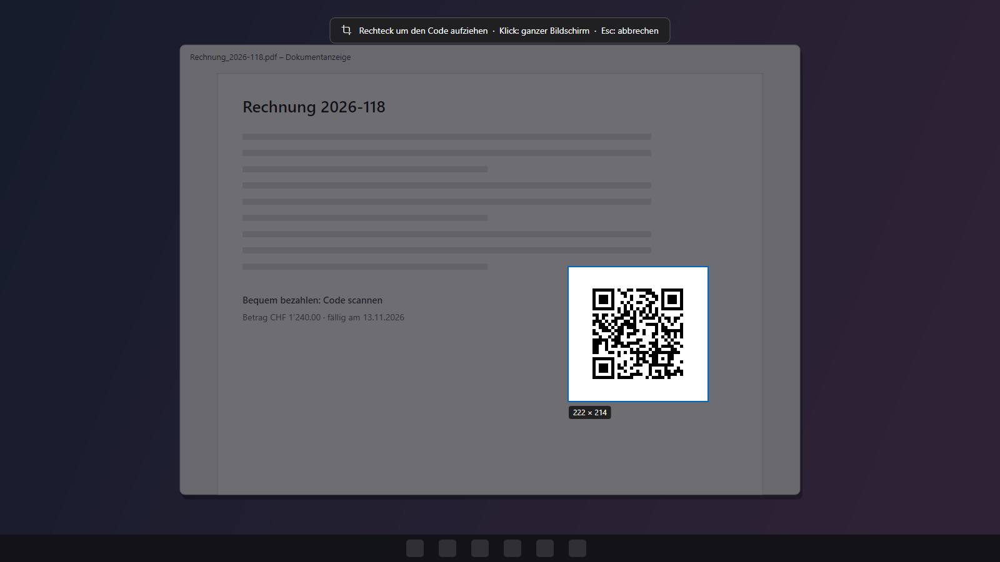
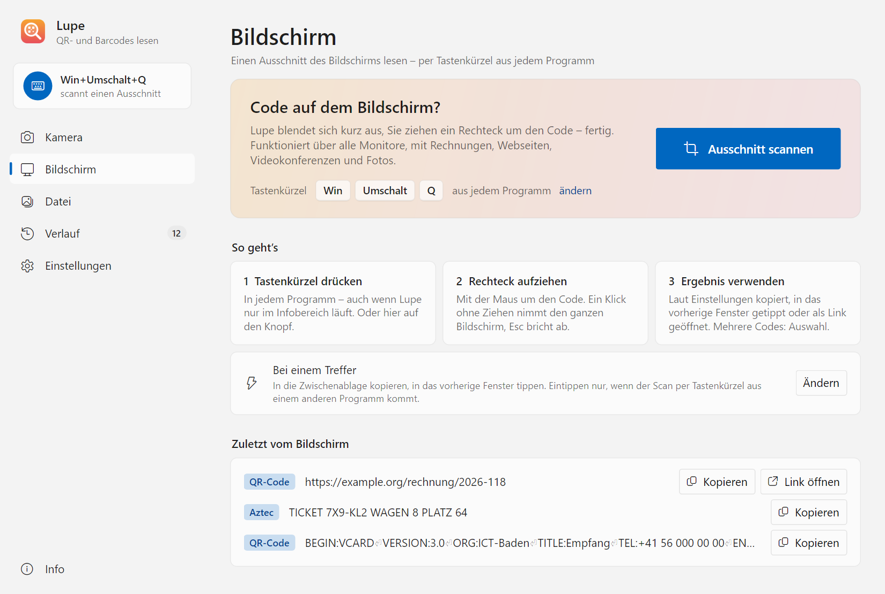
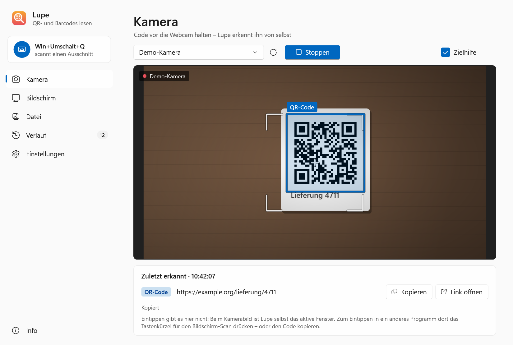
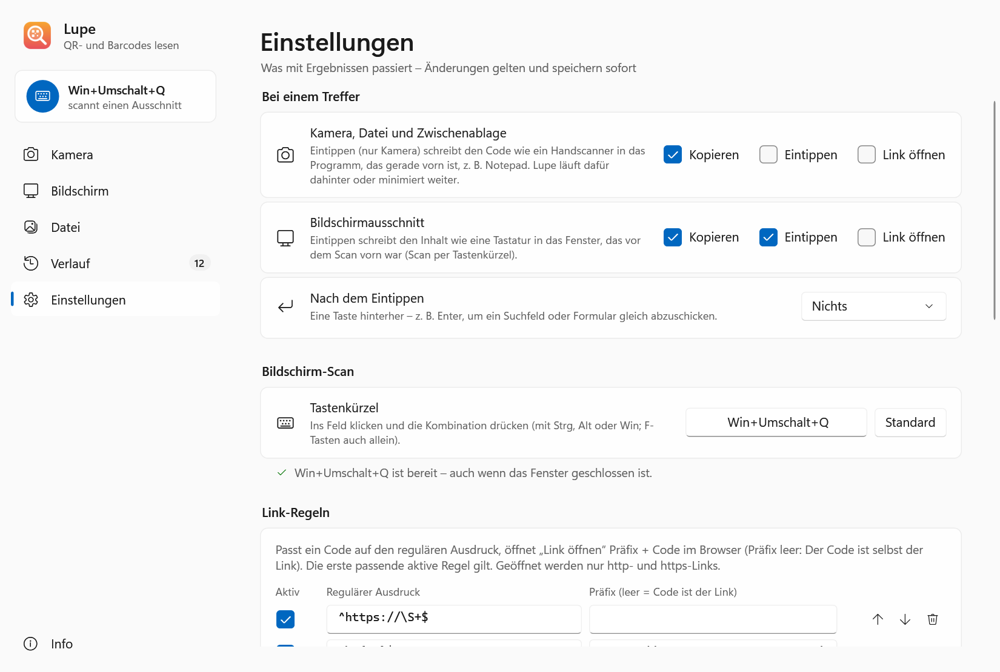
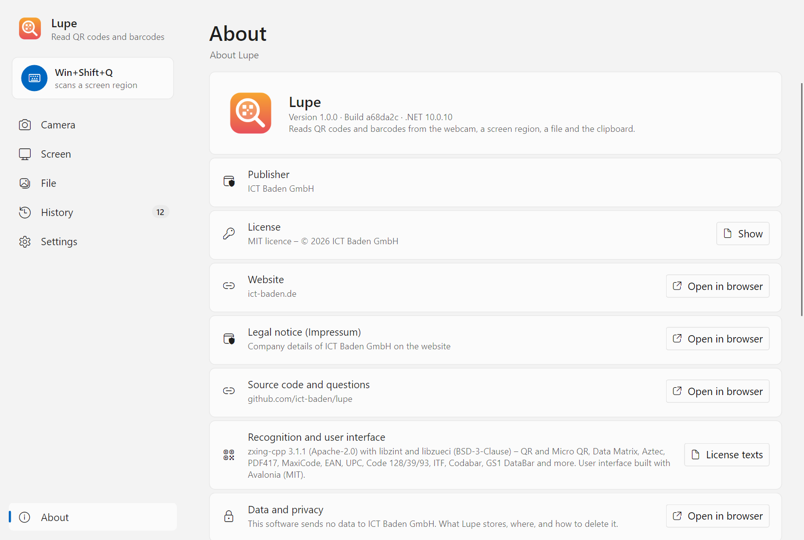

<a href="../README.md">Lupe</a> › <a href="../README.md#documentation">Documentation</a> › Using the app

# Using the app

A walk through every page of the Lupe window and the screen scan, followed by a few typical workflows. The interface is German; each section names the German labels you will see, with a translation.

**Contents:** [Start and navigate](#start-and-navigate) · [The screen scan](#the-screen-scan) · [Bildschirm – screen](#bildschirm--screen) · [Kamera – camera](#kamera--camera) · [Datei – files and clipboard](#datei--files-and-clipboard) · [Verlauf – history](#verlauf--history) · [Einstellungen – settings](#einstellungen--settings) · [Info](#info) · [Workflows](#workflows) · [Glossary](#glossary)

> [!NOTE]
> All screenshots show the built-in demo. Start `Lupe.exe --demo` to try every page without a webcam: it brings a demo camera, a sample history and sample settings – the screen scan copies **and types**, and there are three link rules. A fresh installation only copies and has one link rule. The demo saves nothing, registers no global shortcut and has no notification-area icon; *Ausschnitt scannen* on the page *Bildschirm* still works. The screenshots follow GitHub's light or dark theme; Lupe itself follows the Windows setting.

## Start and navigate

Start Lupe from the Start menu or by running `Lupe.exe` without arguments. The window has a navigation bar on the left:

| Page | Meaning | Shortcut | What it is for |
|---|---|---|---|
| *Kamera* | Camera | <kbd>Ctrl</kbd>+<kbd>1</kbd> | Hold a code in front of the webcam |
| *Bildschirm* | Screen | <kbd>Ctrl</kbd>+<kbd>2</kbd> | Scan a region of the screen; the last results |
| *Datei* | File | <kbd>Ctrl</kbd>+<kbd>3</kbd> | Open an image, drop one, or read the clipboard |
| *Verlauf* | History | <kbd>Ctrl</kbd>+<kbd>4</kbd> | Everything Lupe has read; search, copy, export |
| *Einstellungen* | Settings | <kbd>Ctrl</kbd>+<kbd>5</kbd> | What happens with a result, shortcut, link rules, formats |
| *Info* | About | <kbd>Ctrl</kbd>+<kbd>6</kbd> | Version, origin, data location, command line |

- <kbd>Ctrl</kbd>+<kbd>V</kbd> anywhere outside a text box jumps to *Datei* and reads the image on the clipboard.
- Above the navigation, a card shows the screen-scan shortcut and whether it is ready (*scannt einen Ausschnitt*) or taken by another program (*belegt – siehe Einstellungen*; the entry *Bildschirm* then carries a “!”). Next to *Verlauf* a badge counts the history entries.
- Messages appear in a bar at the bottom of the window. Successes and hints disappear after 8 seconds; warnings and errors stay until you close them.

**Notification area.** As long as Lupe runs, it has an icon there. A click opens the window; the context menu offers *Ausschnitt scannen* (with the shortcut), *Lupe öffnen* and *Beenden* (quit). Closing the window does not quit Lupe – see [Installation › First start](installation.md#first-start).

## The screen scan

The screen scan reads a code that is already on your screen – in a PDF, an e-mail, a web page, a video call or a photo.

<picture>
  <source media="(prefers-color-scheme: dark)" srcset="assets/screenshots/selection-dark.png">
  
</picture>

1. **Start it** – press <kbd>Win</kbd>+<kbd>Shift</kbd>+<kbd>Q</kbd> in any program, choose *Ausschnitt scannen* in the notification-area menu, or click *Ausschnitt scannen* on the page *Bildschirm*. The Lupe window hides itself first.
2. **Select** – Lupe freezes all monitors in one still image and darkens it. Drag a rectangle around the code; the size is shown in pixels next to it.
   - A **click without dragging** takes the whole monitor under the mouse pointer.
   - <kbd>Esc</kbd> or a **right-click** cancels; the window you came from gets the focus back.
3. **Result** – Lupe searches the rectangle with the thorough search and then does what is set under *Einstellungen › Bildschirmausschnitt*:

   | Action | Default | What happens |
   |---|---|---|
   | *Kopieren* | on | The content goes to the clipboard. |
   | *Eintippen* | off | Lupe brings back the window that was active **before** the scan and types the content into it as keyboard input, optionally followed by <kbd>Enter</kbd> or <kbd>Tab</kbd> (*Nach dem Eintippen*). |
   | *Link öffnen* | off | If a [link rule](link-rules.md) matches, the link opens in the default browser. |

   The order is fixed: copy, type, then open the link (the browser takes the focus).

> [!IMPORTANT]
> **Typing only happens when the scan was started with the shortcut from another program.** Started from the Lupe window or from the notification-area menu, the window in front is Lupe itself, so nothing is typed (*Nicht eingetippt: Der Scan kam aus Lupe selbst …*). If the window from before no longer exists or cannot be activated, nothing is typed either – the content never lands in a random window.

### The result notification

When the scan came from another program with the shortcut, or from the notification-area menu while the Lupe window is closed or minimised, the result appears as a small notification at the bottom right of the monitor where you selected. It does not take the focus.

<picture>
  <source media="(prefers-color-scheme: dark)" srcset="assets/screenshots/result-dark.png">
  
</picture>

- Title: the format and *erkannt* (recognised) – after a choice *… gewählt* – or *Kein Code gefunden* with a tip.
- Below the content, what was done: *Kopiert*, *Eingetippt*, *Link geöffnet* – and any problem, for example that the window from before could not be activated.
- *Kopieren* copies again, *Link öffnen* appears when a link rule matches, *In Lupe zeigen* opens the page *Bildschirm*.
- It closes by itself after 8 seconds (5 seconds when nothing was found), but not while the mouse is over it.

When the scan started from Lupe itself – the button on the page *Bildschirm*, the notification-area menu, or the shortcut while a Lupe window is in front – and the Lupe window is open and not minimised, the result is shown in the message bar of the window instead.

### Several codes in the rectangle

If the rectangle contains more than one code, a small window asks *N Codes gefunden – welcher?* (N codes found – which one?). All codes are already in the history; the actions run only for the one you choose:

- Click a code and *Übernehmen* (take), or press its number <kbd>1</kbd>…<kbd>9</kbd>.
- *Alle kopieren* copies all codes, one per line, and does nothing else.
- *Abbrechen* or <kbd>Esc</kbd> runs no action.

## Bildschirm – screen

<picture>
  <source media="(prefers-color-scheme: dark)" srcset="assets/screenshots/screen-dark.png">
  
</picture>

- ***Ausschnitt scannen*** starts a screen scan from here (without typing, see above).
- ***Tastenkürzel*** shows the shortcut as keys; *ändern* leads to the settings. If it could not be registered, a warning with the reason appears here (*Tastenkürzel nicht verfügbar*).
- ***So geht’s*** (how it works) – the three steps: press the shortcut, drag a rectangle, use the result.
- ***Bei einem Treffer*** (on a hit) – the actions currently set for the screen scan in one sentence, e.g. *In die Zwischenablage kopieren, in das vorherige Fenster tippen.* *Ändern* opens the settings.
- ***Zuletzt vom Bildschirm*** – the last eight results of screen scans in this session, each with *Kopieren* and, if a link rule matches, *Link öffnen*.

## Kamera – camera

<picture>
  <source media="(prefers-color-scheme: dark)" srcset="assets/screenshots/camera-dark.png">
  
</picture>

1. Choose the camera in the list. The refresh button (*Kameras neu suchen*) looks for cameras again, e.g. after plugging one in. Lupe remembers the choice.
2. Click ***Kamera starten*** or ***Starten***. The camera only runs while the page is visible: switching to another page, minimising or closing the window stops it, and coming back starts it again.
3. Hold the code in the middle of the picture. ***Zielhilfe*** (aim help) shows corners where the code belongs.
4. A recognised code is outlined and labelled with its format; Lupe beeps (*Ton bei Treffer*), adds it to the history and runs the actions set under *Einstellungen › Kamera, Datei und Zwischenablage* – by default *Kopieren*.

**Repeated codes.** While a code stays in view, it is not reported again. Only after it has **not been seen** for the time set as *Wiederholungssperre* (default 3 seconds) does it count as new. The outline keeps following it in the meantime.

***Zuletzt erkannt*** (last recognised) shows the result with *Kopieren* and *Link öffnen*. With several codes in one picture, all go to the history and the actions do **not** run – copy or open the one you need, or use *Alle kopieren*.

**Typing like a hand scanner.** With *Eintippen* ticked under *Einstellungen › Bei einem Treffer › Kamera, Datei und Zwischenablage*, Lupe types every recognised code into the program that is in front at that moment – click into Notepad, Excel or an ERP form and hold the code in front of the camera. *Nach dem Eintippen* (Enter or Tab) applies here too. Lupe can stay behind that program or be minimised; the camera keeps running while minimised and stops when you switch to another page or close the window. When Lupe itself is in front, nothing is typed (*Nicht eingetippt: Lupe ist gerade das aktive Fenster …*). The repeat suppression keeps a code that stays in view from being typed again. Lupe types with Unicode keyboard input, like the screen scan – the clipboard is not touched (see [How it works › Typing](how-it-works.md#typing)).

If something goes wrong, the picture area explains it, e.g. *Keine Kamera gefunden – Bildschirm oder Datei nutzen* or *Kamera nicht verfügbar* with the reason and *Erneut versuchen* (try again). The camera privacy settings of Windows are explained in [Installation › Camera access](installation.md#camera-access-in-windows).

## Datei – files and clipboard

<picture>
  <source media="(prefers-color-scheme: dark)" srcset="assets/screenshots/file-dark.png">
  
</picture>

Three ways to get an image in:

- ***Bild öffnen …*** (open image) – a file dialog with the image formats Windows can read on this PC.
- **Drag and drop** an image file onto the page – or bitmap data from another program. With several files, the first image is read and a hint says so.
- ***Aus Zwischenablage*** (from clipboard) or <kbd>Ctrl</kbd>+<kbd>V</kbd> – an image copied in a browser or with the Snipping Tool, or an image file copied in Explorer. Without an image on the clipboard, Lupe suggests <kbd>Win</kbd>+<kbd>Shift</kbd>+<kbd>S</kbd> or the screen scan.

Lupe shows the picture with every code outlined and numbered, and lists them under ***N Codes gefunden*** in reading order – top to bottom, left to right – each with *Kopieren* and, if a link rule matches, *Link öffnen*. *Alle kopieren* copies all of them, one per line.

All codes go to the history (source *Datei*, or *Zwischenablage* for the clipboard). With exactly one code, the actions under *Kamera, Datei und Zwischenablage* run; with several, none run – choose yourself.

If nothing is found, the page says *Kein Code gefunden* with a tip. A file that cannot be read gets an explanation – for example that it is incomplete (*… ist unvollständig – die Datei endet mitten im Bild*), that a codec is missing (*Für WEBP fehlt Windows der passende Codec …*), or that another program has it locked.

## Verlauf – history

<picture>
  <source media="(prefers-color-scheme: dark)" srcset="assets/screenshots/history-dark.png">
  
</picture>

- **The list** shows every result, newest first: *Zeit* (time), *Quelle* (source: *Kamera*, *Bildschirm*, *Datei*, *Zwischenablage*), *Format* and *Inhalt* (content). A link symbol marks contents for which a link rule currently matches.
- **Search** (*Inhalt, Format oder Quelle*) filters by content, format or source.
- **The selected entry** is shown below with format, source, time, what was done with it (*Kopiert*, *Eingetippt*, *Link geöffnet* – a later click on *Kopieren* or *Link öffnen* in a result list or in the notification is added) and the link. Buttons: *Kopieren*, *Link öffnen*, *Löschen*.
- **Keys:** double-click or <kbd>Ctrl</kbd>+<kbd>C</kbd> copies, <kbd>Enter</kbd> opens the link, <kbd>Del</kbd> deletes the entry.
- ***Als CSV exportieren …*** writes the whole history as a CSV file for Excel – format: [Data & privacy › CSV export](data-and-privacy.md#csv-export).
- ***Alles löschen*** deletes all entries after a confirmation.

If saving is switched off (*Verlauf speichern*), the page says *Der Verlauf wird nicht gespeichert* – entries exist only until Lupe quits. Problems with the history file appear as *Problem mit der Verlaufsdatei*.

## Einstellungen – settings

<picture>
  <source media="(prefers-color-scheme: dark)" srcset="assets/screenshots/settings-dark.png">
  
</picture>

Changes apply and are saved immediately – there is no *Save* button. The page has these sections: *Bei einem Treffer* (on a hit), *Bildschirm-Scan* (screen scan), *Link-Regeln* (link rules), *Formate* (formats), *Kamera*, *Verlauf* (history) and *Start und Infobereich* (start and notification area); at the bottom, the location of the settings file with *Ordner öffnen*. Every setting with its default: **[Settings](settings.md)**. Link rules in detail: **[Link rules](link-rules.md)**.

## Info

<picture>
  <source media="(prefers-color-scheme: dark)" srcset="assets/screenshots/about-dark.png">
  
</picture>

Version and .NET version, publisher, *Lizenz: MIT-Lizenz – © 2026 ICT-Baden GmbH*, the source code link, the decoding and UI libraries (*Erkennung und Oberfläche*: zxing-cpp, Apache-2.0, with libzint and libzueci, BSD-3-Clause; *Lizenztexte* opens the licence texts of all bundled components), *Ihre Daten* (your data) with *Ordner öffnen* for `%LocalAppData%\Lupe`, a short introduction to the command line with the exit codes, and the keyboard shortcuts (*Tastatur*).

## Workflows

### Scan from the screen, type into the ERP

A delivery note arrives as a PDF; the delivery note number is a Code 128 and should go into the goods-receipt form of the ERP.

1. **Once:** *Einstellungen › Bildschirmausschnitt* – tick *Eintippen* (and leave *Kopieren* on if you also want it on the clipboard). Under *Nach dem Eintippen* choose *Tab* to jump to the next field, or *Enter* to submit a search field.
2. Put the cursor into the field of the ERP.
3. Press <kbd>Win</kbd>+<kbd>Shift</kbd>+<kbd>Q</kbd>, drag a rectangle around the barcode in the PDF.
4. Lupe activates the ERP window again and types the number. The notification confirms *Kopiert · Eingetippt*.

Things to know: line breaks in the content are typed as <kbd>Enter</kbd> and tabs as <kbd>Tab</kbd>; other control characters are dropped. If the ERP runs as administrator, Lupe cannot type into it unless Lupe also runs as administrator ([details](installation.md#running-as-administrator)).

### Open the item page for a barcode

Product labels carry an EAN-13; your web shop or ERP has a page per item, e.g. `https://warenwirtschaft.example/artikel/4012345000009`.

1. *Einstellungen › Link-Regeln › Regel hinzufügen*: pattern `^\d{13}$`, prefix `https://warenwirtschaft.example/artikel/`.
2. Type a code into *Code zum Ausprobieren* to check: `4012345000009` → `https://warenwirtschaft.example/artikel/4012345000009`.
3. Tick *Link öffnen* for the sources where it should happen automatically – e.g. *Kamera, Datei und Zwischenablage*. Without it, *Link öffnen* is still offered as a button next to every matching result.

More patterns and the safety rules: [Link rules](link-rules.md).

### Several codes from one document

A label or a PDF carries a QR code, a serial number as Data Matrix and an EAN. Scan the whole area once; in the selection window choose the code you need, or *Alle kopieren* to get all contents one per line. For an image file, the page *Datei* lists all codes at once.

### Many image files

For a folder of scans, use the command line – one line per code, ready for a script: `Lupe.exe lesen C:\Scans\*.jpg`. See [Command line](command-line.md).

## Glossary

| German | English | Notes |
|---|---|---|
| *Kamera / Bildschirm / Datei / Zwischenablage* | camera / screen / file / clipboard | the sources, also in the history and the CSV |
| *Ausschnitt scannen* | scan a region | the screen scan |
| *Bildschirmausschnitt* | screen region | settings group for the screen scan |
| *Tastenkürzel* | keyboard shortcut | default *Win+Umschalt+Q* = <kbd>Win</kbd>+<kbd>Shift</kbd>+<kbd>Q</kbd> |
| *Strg / Umschalt / Entf / Eingabe* | <kbd>Ctrl</kbd> / <kbd>Shift</kbd> / <kbd>Del</kbd> / <kbd>Enter</kbd> | key names as Lupe writes them |
| *Kopieren* | copy | to the clipboard |
| *Eintippen* | type | keyboard input into the previous window |
| *Link öffnen* | open link | in the default browser, only `http`/`https` |
| *Link-Regel* | link rule | pattern (*regulärer Ausdruck*) plus *Präfix* |
| *Treffer* | hit | a recognised code |
| *Zielhilfe* | aim help | corners in the camera picture |
| *Wiederholungssperre* | repeat suppression | how long the same code is not reported again |
| *Verlauf* | history | |
| *Infobereich* | notification area | system tray |
| *Kein Code gefunden* | no code found | |

---

<a href="installation.md">Installation</a> · <b>Using the app</b> · <a href="settings.md">Settings</a> · <a href="link-rules.md">Link rules</a> · <a href="command-line.md">Command line</a> · <a href="how-it-works.md">How it works</a> · <a href="data-and-privacy.md">Data &amp; privacy</a> · <a href="limitations.md">Limitations</a> · <a href="development.md">Development</a> 
<a href="../README.md">← Back to Lupe</a>

