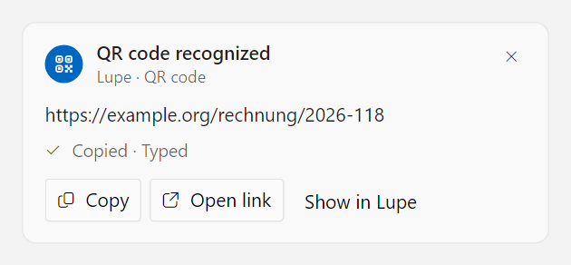
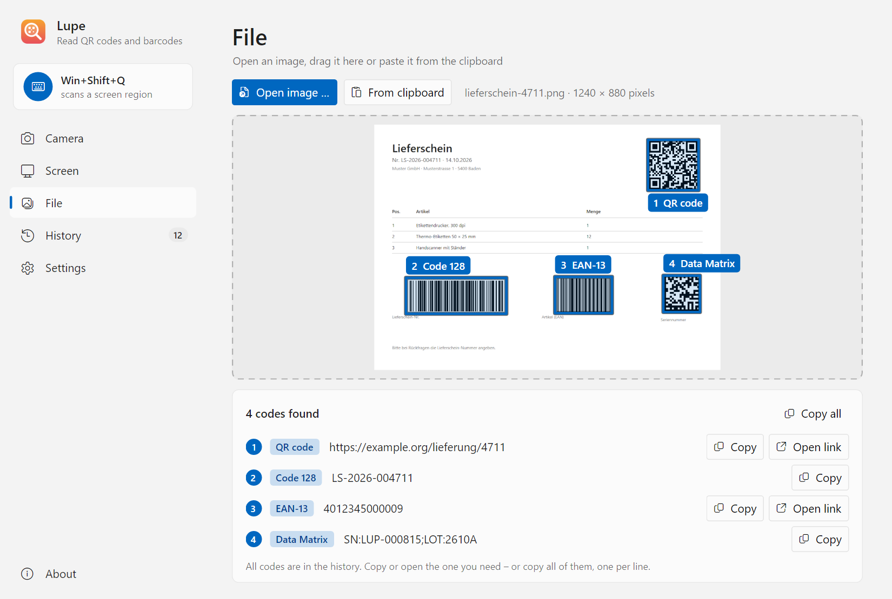
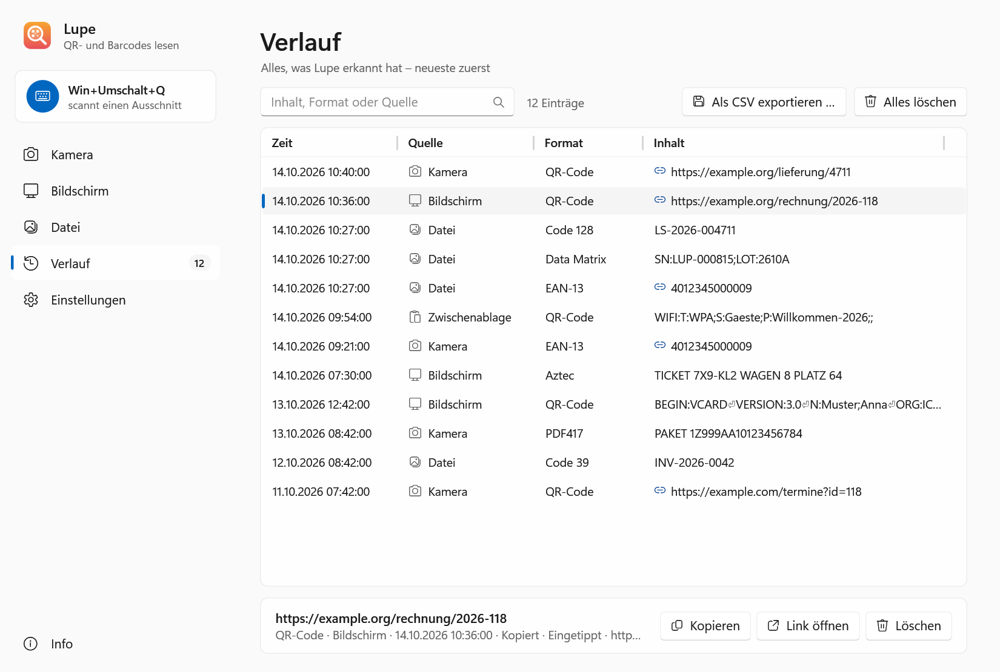

<a href="../README.md">Lupe</a> › <a href="../README.md#documentation">Documentation</a> › Using the app

# Using the app

A walk through every page of the Lupe window and the screen scan, followed by a few typical workflows. The interface follows the system language (English, German, Spanish, French or Chinese); the screenshots and this guide show the English labels. The German interface shows the German equivalents – the [Glossary](#glossary) lists the most important ones.

**Contents:** [Start and navigate](#start-and-navigate) · [The screen scan](#the-screen-scan) · [Screen](#screen) · [Camera](#camera) · [File – files and clipboard](#file--files-and-clipboard) · [History](#history) · [Settings](#settings) · [About](#about) · [Workflows](#workflows) · [Glossary](#glossary)

> [!NOTE]
> All screenshots show the built-in demo. Start `Lupe.exe --demo` to try every page without a webcam: it brings a demo camera, a sample history and sample settings – the screen scan copies **and types**, and there are three link rules. A fresh installation only copies and has one link rule. The demo saves nothing, registers no global shortcut and has no notification-area icon; *Scan region* on the page *Screen* still works. The screenshots follow GitHub's light or dark theme; Lupe itself follows the Windows setting.

## Start and navigate

Start Lupe from the Start menu or by running `Lupe.exe` without arguments. The window has a navigation bar on the left:

| Page | Shortcut | What it is for |
|---|---|---|
| *Camera* | <kbd>Ctrl</kbd>+<kbd>1</kbd> | Hold a code in front of the webcam |
| *Screen* | <kbd>Ctrl</kbd>+<kbd>2</kbd> | Scan a region of the screen; the last results |
| *File* | <kbd>Ctrl</kbd>+<kbd>3</kbd> | Open an image, drop one, or read the clipboard |
| *History* | <kbd>Ctrl</kbd>+<kbd>4</kbd> | Everything Lupe has read; search, copy, export |
| *Settings* | <kbd>Ctrl</kbd>+<kbd>5</kbd> | What happens with a result, shortcut, link rules, formats |
| *About* | <kbd>Ctrl</kbd>+<kbd>6</kbd> | Version, licence, website and legal notice, licence texts, data location, command line |

- <kbd>Ctrl</kbd>+<kbd>V</kbd> anywhere outside a text box jumps to *File* and reads the image on the clipboard.
- Above the navigation, a card shows the screen-scan shortcut and whether it is ready (*scans a screen region*) or taken by another program (*not available – see Settings*; the entry *Screen* then carries a “!”). Next to *History* a badge counts the history entries.
- Messages appear in a bar at the bottom of the window. Successes and hints disappear after 8 seconds; warnings and errors stay until you close them.

**Notification area.** As long as Lupe runs, it has an icon there. A click opens the window; the context menu offers *Scan region* (with the shortcut), *Open Lupe* and *Quit*. Closing the window does not quit Lupe – see [Installation › First start](installation.md#first-start).

## The screen scan

The screen scan reads a code that is already on your screen – in a PDF, an e-mail, a web page, a video call or a photo.

<picture>
  <source media="(prefers-color-scheme: dark)" srcset="assets/screenshots/selection-dark.png">
  
</picture>

1. **Start it** – press <kbd>Win</kbd>+<kbd>Shift</kbd>+<kbd>Q</kbd> in any program, choose *Scan region* in the notification-area menu, or click *Scan region* on the page *Screen*. The Lupe window hides itself first.
2. **Select** – Lupe freezes all monitors in one still image and darkens it. Drag a rectangle around the code; the size is shown in pixels next to it.
   - A **click without dragging** takes the whole monitor under the mouse pointer.
   - <kbd>Esc</kbd> or a **right-click** cancels; the window you came from gets the focus back.
3. **Result** – Lupe searches the rectangle with the thorough search and then does what is set under *Settings › Screen region*:

   | Action | Default | What happens |
   |---|---|---|
   | *Copy* | on | The content goes to the clipboard. |
   | *Type* | off | Lupe brings back the window that was active **before** the scan and types the content into it as keyboard input, optionally followed by <kbd>Enter</kbd> or <kbd>Tab</kbd> (*After typing*). |
   | *Open link* | off | If a [link rule](link-rules.md) matches, the link opens in the default browser. |

   The order is fixed: copy, type, then open the link (the browser takes the focus).

> [!IMPORTANT]
> **Typing only happens when the scan was started with the shortcut from another program.** Started from the Lupe window or from the notification-area menu, the window in front is Lupe itself, so nothing is typed (*Not typed: the scan came from Lupe itself …*). If the window from before no longer exists or cannot be activated, nothing is typed either – the content never lands in a random window.

### The result notification

When the scan came from another program with the shortcut, or from the notification-area menu while the Lupe window is closed or minimised, the result appears as a small notification at the bottom right of the monitor where you selected. It does not take the focus.

<picture>
  <source media="(prefers-color-scheme: dark)" srcset="assets/screenshots/result-dark.png">
  
</picture>

- Title: the format and *recognized* – after a choice *… selected* – or *No code found* with a tip.
- Below the content, what was done: *Copied*, *Typed*, *Link opened* – and any problem, for example that the window from before could not be activated.
- *Copy* copies again, *Open link* appears when a link rule matches, *Show in Lupe* opens the page *Screen*.
- It closes by itself after 8 seconds (5 seconds when nothing was found), but not while the mouse is over it.

When the scan started from Lupe itself – the button on the page *Screen*, the notification-area menu, or the shortcut while a Lupe window is in front – and the Lupe window is open and not minimised, the result is shown in the message bar of the window instead.

### Several codes in the rectangle

If the rectangle contains more than one code, a small window asks *N codes found – which one?*. All codes are already in the history; the actions run only for the one you choose:

- Click a code and *Apply*, or press its number <kbd>1</kbd>…<kbd>9</kbd>.
- *Copy all* copies all codes, one per line, and does nothing else.
- *Cancel* or <kbd>Esc</kbd> runs no action.

## Screen

<picture>
  <source media="(prefers-color-scheme: dark)" srcset="assets/screenshots/screen-dark.png">
  
</picture>

- ***Scan region*** starts a screen scan from here (without typing, see above).
- ***Keyboard shortcut*** shows the shortcut as keys; *change* leads to the settings. If it could not be registered, a warning with the reason appears here (*Keyboard shortcut not available*).
- ***How it works*** – the three steps: press the shortcut, drag a rectangle, use the result.
- ***On a detected code*** – the actions currently set for the screen scan in one sentence, e.g. *Copy to the clipboard, type into the previous window.* *Change* opens the settings.
- ***Recently from the screen*** – the last eight results of screen scans in this session, each with *Copy* and, if a link rule matches, *Open link*.

## Camera

<picture>
  <source media="(prefers-color-scheme: dark)" srcset="assets/screenshots/camera-dark.png">
  
</picture>

1. Choose the camera in the list. The refresh button (*Search for cameras again*) looks for cameras again, e.g. after plugging one in. Lupe remembers the choice.
2. Click ***Start camera*** or ***Start***. The camera only runs while the page is visible: switching to another page, minimising or closing the window stops it, and coming back starts it again.
3. Hold the code in the middle of the picture. ***Aim guide*** shows corners where the code belongs.
4. A recognised code is outlined and labelled with its format; Lupe beeps (*Sound on detection*), adds it to the history and runs the actions set under *Settings › Camera, file and clipboard* – by default *Copy*.

**Repeated codes.** While a code stays in view, it is not reported again. Only after it has **not been seen** for the time set as *Repeat lock* (default 3 seconds) does it count as new. The outline keeps following it in the meantime.

***Last detected*** shows the result with *Copy* and *Open link*. With several codes in one picture, all go to the history and the actions do **not** run – copy or open the one you need, or use *Copy all*.

**Typing like a hand scanner.** With *Type* ticked under *Settings › On a detected code › Camera, file and clipboard*, Lupe types every recognised code into the program that is in front at that moment – click into Notepad, Excel or an ERP form and hold the code in front of the camera. *After typing* (Enter or Tab) applies here too. Lupe can stay behind that program or be minimised; the camera keeps running while minimised and stops when you switch to another page or close the window. When Lupe itself is in front, nothing is typed (*Not typed: Lupe is currently the active window …*). The repeat suppression keeps a code that stays in view from being typed again. Lupe types with Unicode keyboard input, like the screen scan – the clipboard is not touched (see [How it works › Typing](how-it-works.md#typing)).

If something goes wrong, the picture area explains it, e.g. *No camera found – use Screen or File* or *Camera not available* with the reason and *Try again*. The camera privacy settings of Windows are explained in [Installation › Camera access](installation.md#camera-access-in-windows).

## File – files and clipboard

<picture>
  <source media="(prefers-color-scheme: dark)" srcset="assets/screenshots/file-dark.png">
  
</picture>

Three ways to get an image in:

- ***Open image …*** – a file dialog with the image formats Windows can read on this PC.
- **Drag and drop** an image file onto the page – or bitmap data from another program. With several files, the first image is read and a hint says so.
- ***From clipboard*** or <kbd>Ctrl</kbd>+<kbd>V</kbd> – an image copied in a browser or with the Snipping Tool, or an image file copied in Explorer. Without an image on the clipboard, Lupe suggests <kbd>Win</kbd>+<kbd>Shift</kbd>+<kbd>S</kbd> or the screen scan.

Lupe shows the picture with every code outlined and numbered, and lists them under ***N codes found*** in reading order – top to bottom, left to right – each with *Copy* and, if a link rule matches, *Open link*. *Copy all* copies all of them, one per line.

All codes go to the history (source *File*, or *Clipboard* for the clipboard). With exactly one code, the actions under *Camera, file and clipboard* run; with several, none run – choose yourself.

If nothing is found, the page says *No code found* with a tip. A file that cannot be read gets an explanation – for example that it is incomplete (*… is incomplete – the file ends in the middle of the image*), that a codec is missing (*… Windows lacks the codec for WEBP …*), or that another program has it locked.

## History

<picture>
  <source media="(prefers-color-scheme: dark)" srcset="assets/screenshots/history-dark.png">
  
</picture>

- **The list** shows every result, newest first: *Time*, *Source* (*Camera*, *Screen*, *File*, *Clipboard*), *Format* and *Content*. A link symbol marks contents for which a link rule currently matches.
- **Search** (*Content, format or source*) filters by content, format or source.
- **The selected entry** is shown below with format, source, time, what was done with it (*Copied*, *Typed*, *Link opened* – a later click on *Copy* or *Open link* in a result list or in the notification is added) and the link. Buttons: *Copy*, *Open link*, *Delete*.
- **Keys:** double-click or <kbd>Ctrl</kbd>+<kbd>C</kbd> copies, <kbd>Enter</kbd> opens the link, <kbd>Del</kbd> deletes the entry.
- ***Export as CSV …*** writes the whole history as a CSV file for Excel – format: [Data & privacy › CSV export](data-and-privacy.md#csv-export).
- ***Delete all*** deletes all entries after a confirmation.

If saving is switched off (*Save history*), the page says *The history is not being saved* – entries exist only until Lupe quits. Problems with the history file appear as *Problem with the history file*.

## Settings

<picture>
  <source media="(prefers-color-scheme: dark)" srcset="assets/screenshots/settings-dark.png">
  
</picture>

Changes apply and are saved immediately – there is no *Save* button. The page has these sections: *On a detected code*, *Screen scan*, *Link rules*, *Formats*, *Camera*, *History* and *Startup and notification area*; at the bottom, the location of the settings file with *Open folder*. Every setting with its default: **[Settings](settings.md)**. Link rules in detail: **[Link rules](link-rules.md)**.

## About

<picture>
  <source media="(prefers-color-scheme: dark)" srcset="assets/screenshots/about-dark.png">
  
</picture>

Version, build (commit) and .NET version, publisher, *License* (*MIT licence – © 2026 ICT-Baden GmbH*) with *Show* (shows the licence text that ships with Lupe), *Website* and *Legal notice (Impressum)* on ict-baden.de, the source code link, the decoding and UI libraries (*Recognition and user interface*: zxing-cpp, Apache-2.0, with libzint and libzueci, BSD-3-Clause; *License texts* opens the licence texts of all bundled components), *Data and privacy* (“This software sends no data to ICT-Baden”, links to the [privacy notice for Lupe](https://ict-baden.de/datenschutz/lupe/) on ict-baden.de; the details are in [Data & privacy](data-and-privacy.md)), *Help & support* (free via GitHub, guaranteed with a support contract, links to [SUPPORT.md](../SUPPORT.md)), *Your data* with *Open folder* for `%LocalAppData%\Lupe`, a short introduction to the command line with the exit codes, and the keyboard shortcuts (*Keyboard*).

## Workflows

### Scan from the screen, type into the ERP

A delivery note arrives as a PDF; the delivery note number is a Code 128 and should go into the goods-receipt form of the ERP.

1. **Once:** *Settings › Screen region* – tick *Type* (and leave *Copy* on if you also want it on the clipboard). Under *After typing* choose *Tab* to jump to the next field, or *Enter* to submit a search field.
2. Put the cursor into the field of the ERP.
3. Press <kbd>Win</kbd>+<kbd>Shift</kbd>+<kbd>Q</kbd>, drag a rectangle around the barcode in the PDF.
4. Lupe activates the ERP window again and types the number. The notification confirms *Copied · Typed*.

Things to know: line breaks in the content are typed as spaces – a code must not be able to press <kbd>Enter</kbd> in the ERP – and tabs as <kbd>Tab</kbd>; other control characters are dropped. Use *Copy* for multi-line contents. If the ERP runs as administrator, Lupe cannot type into it unless Lupe also runs as administrator ([details](installation.md#running-as-administrator)).

### Open the item page for a barcode

Product labels carry an EAN-13; your web shop or ERP has a page per item, e.g. `https://warenwirtschaft.example/artikel/4012345000009`.

1. *Settings › Link rules › Add rule*: pattern `^\d{13}$`, prefix `https://warenwirtschaft.example/artikel/`.
2. Type a code into *Code to try out* to check: `4012345000009` → `https://warenwirtschaft.example/artikel/4012345000009`.
3. Tick *Open link* for the sources where it should happen automatically – e.g. *Camera, file and clipboard*. Without it, *Open link* is still offered as a button next to every matching result.

More patterns and the safety rules: [Link rules](link-rules.md).

### Several codes from one document

A label or a PDF carries a QR code, a serial number as Data Matrix and an EAN. Scan the whole area once; in the selection window choose the code you need, or *Copy all* to get all contents one per line. For an image file, the page *File* lists all codes at once.

### Many image files

For a folder of scans, use the command line – one line per code, ready for a script: `Lupe.exe read C:\Scans\*.jpg`. See [Command line](command-line.md).

## Glossary

The labels of the English interface and their counterparts in the German one:

| English | German | Notes |
|---|---|---|
| *Camera / Screen / File / Clipboard* | *Kamera / Bildschirm / Datei / Zwischenablage* | the sources, also in the history and the CSV |
| *Scan region* | *Ausschnitt scannen* | the screen scan |
| *Screen region* | *Bildschirmausschnitt* | settings group for the screen scan |
| *Keyboard shortcut* | *Tastenkürzel* | default *Win+Shift+Q* (German *Win+Umschalt+Q*) |
| *Ctrl / Shift / Delete / Enter* | *Strg / Umschalt / Entf / Eingabe* | key names as Lupe writes them |
| *Copy* | *Kopieren* | to the clipboard |
| *Type* | *Eintippen* | keyboard input into the previous window |
| *Open link* | *Link öffnen* | in the default browser, only `http`/`https` |
| *Link rules* | *Link-Regeln* | *Regular expression* (*Regulärer Ausdruck*) plus *Prefix* (*Präfix*) |
| *On a detected code* | *Bei einem Treffer* | what happens with a recognised code |
| *Aim guide* | *Zielhilfe* | corners in the camera picture |
| *Repeat lock* | *Wiederholungssperre* | how long the same code is not reported again |
| *History* | *Verlauf* | |
| notification area | *Infobereich* | system tray |
| *No code found* | *Kein Code gefunden* | |

---

<a href="installation.md">Installation</a> · <b>Using the app</b> · <a href="settings.md">Settings</a> · <a href="link-rules.md">Link rules</a> · <a href="command-line.md">Command line</a> · <a href="how-it-works.md">How it works</a> · <a href="data-and-privacy.md">Data &amp; privacy</a> · <a href="limitations.md">Limitations</a> · <a href="development.md">Development</a> 
<a href="../README.md">← Back to Lupe</a>

